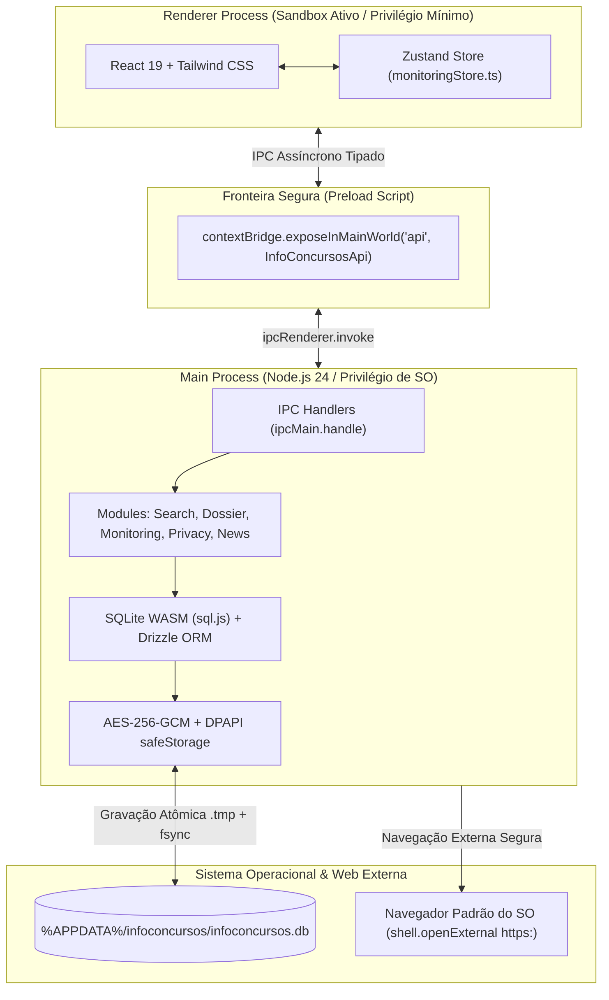
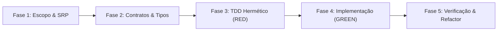

# Manual Normativo de Engenharia e Desenvolvimento — InfoConcursos Desktop (dev-agent.md)

> **Status:** Documento Normativo, Vinculante e Perpétuo para o Agente de IA e Desenvolvedores.  
> **Escopo:** Toda a base de código do InfoConcursos (`src/main`, `src/preload`, `src/renderer`, `src/shared`, `src/test`, scripts e configurações de build).  
> **Regra de Ouro:** Este manual deve ser consultado e seguido rigorosamente em **toda e qualquer** tarefa técnica. Nenhum atalho, stub, falsa implementação, bypass de tipos ou adulteração de testes será tolerado.

---

## 📌 Sumário Normativo

1. [Princípios Fundamentais & Invariante Zero Fake Data](#1-princípios-fundamentais--invariante-zero-fake-data)
2. [Arquitetura de Processos e Isolamento Desktop (Electron 34)](#2-arquitetura-de-processos-e-isolamento-desktop-electron-34)
3. [Protocolo Operacional em 5 Fases para Tarefas Técnicas](#3-protocolo-operacional-em-5-fases-para-tarefas-técnicas)
4. [Tratamento de Erros, Resiliência e Logs (LGPD)](#4-tratamento-de-erros-resiliência-e-logs-lgpd)
5. [Anti-Duplicação (DRY) e Single Source of Truth (SSOT)](#5-anti-duplicação-dry-e-single-source-of-truth-ssot)
6. [Design de Interface: Swiss Monocle Editorial vs. AI-Like](#6-design-de-interface-swiss-monocle-editorial-vs-ai-like)
7. [Desktop-First UX e Interação Nativa](#7-desktop-first-ux-e-interação-nativa)
8. [Integridade de Tipos, Linters e Rigor de Testes (Khorikov / BVA)](#8-integridade-de-tipos-linters-e-rigor-de-testes-khorikov--bva)
9. [Prevenção de Falsa Implementação e Loops de Refatoração](#9-prevenção-de-falsa-implementação-e-loops-de-refatoração)
10. [Versionamento, Migrações e Portão Hermético de Build](#10-versionamento-migrações-e-portão-hermético-de-build)
11. [Matriz Canônica de Fontes e Referências Técnicas/Acadêmicas](#11-matriz-canônica-de-fontes-e-referências-técnicasacadêmicas)

---

## 1. Princípios Fundamentais & Invariante Zero Fake Data

1. **Invariante Inflexível "Zero Fake Data":**
   - É terminantemente proibido inventar, estimar ou alucinar dados factuais (salários, prazos, vagas, nomes de bancas).
   - Se a fonte oficial primária ou o edital não especificar uma informação, declare estritamente os fallbacks oficiais:
     - Previsão de cronograma / edital: `"A definir pelo órgão"`
     - Remuneração / salários: `"Não especificado na publicação"`
     - Vagas: `"Conforme edital"` ou `"CR"` (Cadastro de Reserva)
   - Qualquer regressão que introduza dados sintéticos é considerada bug crítico.

2. **Princípio da Responsabilidade Única (SRP - Robert C. Martin):**
   - Cada módulo, classe ou arquivo deve ter apenas **um único motivo para mudar**.
   - Parsers de bancas mudam apenas se a estrutura do HTML da banca mudar.
   - Handlers IPC cuidam apenas de validar contratos de entrada/saída e delegar aos serviços.
   - Componentes React cuidam apenas da projeção visual dos dados.

3. **Regra do Menor Poder (Rule of Least Power - W3C / Tim Berners-Lee):**
   - Escolha a ferramenta mais simples e menos expressiva capaz de resolver o problema com determinismo.
   - Se um seletor CSS Cheerio ou uma função pura TypeScript resolve o problema com 0ms e 100% de previsibilidade, nunca utilize modelos estocásticos de IA ou loops reflexivos.

4. **Functional Core, Imperative Shell (Gary Bernhardt):**
   - O núcleo da aplicação (sanitização de texto, extração de datas, decodificação de URLs, casamento de matriz curricular) deve ser composto de **funções puras, determinísticas e síncronas**.
   - Efeitos colaterais (chamadas HTTP, I/O de disco, consultas SQLite, chamadas IPC) ficam restritos à casca externa.

---

## 2. Arquitetura de Processos e Isolamento Desktop (Electron 34)

A arquitetura do InfoConcursos segue o padrão de **Defesa em Profundidade** baseado no *Chromium Multi-Process Architecture* e no *Doyensec Checklist*:



### Regras Mandatórias de Segurança no Electron:
- **`sandbox: true`**, **`contextIsolation: true`**, **`nodeIntegration: false`**, **`webviewTag: false`** em `webPreferences`.
- O Renderer **nunca** faz requisições HTTP diretamente. A CSP bloqueia `connect-src` externo. Toda coleta passa pelo Main via IPC.
- Navegações e redirecionamentos (`will-navigate`, `will-redirect`, `setWindowOpenHandler`) são cancelados (`event.preventDefault()`) e links externos válidos `https:` são delegados exclusivamente ao navegador padrão via `shell.openExternal`.
- Negação explícita de permissões nativas de hardware via `setPermissionCheckHandler(() => false)` e `setPermissionRequestHandler((_wc, _p, cb) => cb(false))`.

---

## 3. Protocolo Operacional em 5 Fases para Tarefas Técnicas

Ao receber qualquer tarefa de desenvolvimento, manutenção ou refatoração, o agente deve seguir obrigatoriamente as 5 fases:



1. **Fase 1 — Decomposição de Escopo e SRP:**
   - Delimitar o arquivo e a camada exata da mudança.
   - Proibido modificar arquivos colaterais não relacionados à tarefa.
2. **Fase 2 — Contratos e Tipagem Estática (TypeScript First):**
   - Definir contratos de dados em `src/shared/types/` ou schemas em `src/main/database/schema.ts`.
   - Garantir que todos os dados que trafegam via IPC sejam serializáveis.
3. **Fase 3 — Ciclo TDD Hermético (RED):**
   - Escrever o teste unitário antes ou em paralelo analítico com a especificação em `src/test/`.
   - Estrutura AAA canônica (Arrange, Act, Assert) com princípio DAMP.
   - Cobrir a matriz BVA (casos limites, strings vazias, valores nulos, erros de rede).
   - Hermeticidade estrita: zero rede real, banco em `:memory:`.
4. **Fase 4 — Implementação Mínima Focada (GREEN):**
   - Escrever o código estritamente necessário para satisfazer as asserções semânticas.
   - Proibido criar frameworks ou abstrações genéricas antecipadas (YAGNI).
5. **Fase 5 — Verificação Dupla e Refatoração Limpa (REFACTOR):**
   - Rodar checagem estática completa: `npm run typecheck`.
   - Rodar suíte de testes: `npm test`.
   - Garantir que nenhum mutante sobrevive e nenhuma regra de tipagem foi violada.

---

## 4. Tratamento de Erros, Resiliência e Logs (LGPD)

### 4.1 Proibição de Silenciamento Cego de Exceções
- ❌ **Anti-Padrão Banido:**
  ```typescript
  try {
    return await fetch(url)
  } catch {
    return null // SILENCIAMENTO CEGO: Proibido!
  }
  ```
- ✔️ **Padrão Obrigatório (Result Pattern / Erros Tipados):**
  Toda operação externa suscetível a falhas deve retornar tipos discriminados ou lançar erros semânticos categorizados:
  ```typescript
  export type NetworkResult<T> =
    | { success: true; data: T; statusCode: number }
    | { success: false; error: 'TIMEOUT' | 'RATE_LIMITED' | 'NETWORK_FAILURE' | 'INVALID_CONTENT'; statusCode?: number }
  ```

### 4.2 Error Boundary na Camada de Interface
- Toda a árvore React deve ser envelopada por um `ErrorBoundary` documental.
- Em caso de falha de renderização, o usuário deve receber uma tela de recuperação com feedback claro e botão "Tentar Novamente", impedindo a janela em branco (*blank screen*).

### 4.3 Captura Global de Processo no Main
- O processo Node.js principal deve registrar:
  ```typescript
  process.on('uncaughtException', (err) => {
    console.error('[CRITICAL] Uncaught exception:', anonymizeText(err.message, 'LOG_OUTPUT'))
    closeDatabase()
    process.exit(1)
  })
  process.on('unhandledRejection', (reason) => {
    console.error('[CRITICAL] Unhandled rejection:', anonymizeText(String(reason), 'LOG_OUTPUT'))
  })
  ```

### 4.4 Sanitização Ativa de Logs e PII (Art. 46 LGPD)
- Proibido logar dados pessoais no console ou em arquivos de log.
- Todo log que manipular mensagens de erro, URLs ou termos de busca deve passar por `anonymizeText(texto, 'LOG_OUTPUT')`, mascarando nomes de usuários (`C:\Users\[USUARIO]`), CPFs, e-mails e tokens de rede.

---

## 5. Anti-Duplicação (DRY) e Single Source of Truth (SSOT)

1. **Lógica de Domínio Centralizada:**
   - Funções de inferência de status de concurso, área funcional ou UF **nunca devem ser recriadas dentro de scrapers individuais**.
   - Módulos de autoridade única:
     - Detecção de Status: [`src/main/modules/dossier/status-detector.ts`](file:///c:/Users/Dev/develop/infoconcursos/src/main/modules/dossier/status-detector.ts)
     - Normalização e Extração de Datas: [`src/main/modules/dossier/date-extractor.ts`](file:///c:/Users/Dev/develop/infoconcursos/src/main/modules/dossier/date-extractor.ts)
     - Anonimização e LGPD: [`src/shared/utils/anonymizer.ts`](file:///c:/Users/Dev/develop/infoconcursos/src/shared/utils/anonymizer.ts)
     - Registro Canônico de Bancas e Portais: [`src/shared/constants/sources-registry.ts`](file:///c:/Users/Dev/develop/infoconcursos/src/shared/constants/sources-registry.ts)

2. **Componentização Visual Estrita (Design System First):**
   - É proibido criar botões, inputs, chips ou tipografia com classes Tailwind inline dispersas quando já existe átomo ou molécula correspondente em [`src/renderer/src/components/ds/`](file:///c:/Users/Dev/develop/infoconcursos/src/renderer/src/components/ds/).
   - Se uma variação for necessária, ela deve ser implementada no átomo em `components/ds/` com prop tipada.

3. **Banimento de Stubs e Mocks em Produção:**
   - Métodos não podem conter blocos vazios `{}` ou retornos falsos (`return []`, `return true`) destinados a "completar depois". A entrega deve ser ponta a ponta.

---

## 6. Design de Interface: Swiss Monocle Editorial vs. AI-Like

A estética visual do InfoConcursos rejeita templates genéricos de IA (gradientes roxos saturados, cantos `rounded-3xl` em tudo, cards flutuantes sem propósito, espaços vazios esterilizados).

```
+-----------------------------------------------------------------------------------+
|  [Header Fixo / Retrátil: InfoConcursos • Editorial, Busca & Dossiês]             |
+-----------------------------------------------------------------------------------+
|  MANCHETE PRINCIPAL (Newsreader Serif, Alto Contraste, Floral White #FFFCF2)     |
|  Síntese documental analítica com badges institucionais (Deep Teal #607466)       |
+-----------------------------------------------------------------------------------+
|  FAIXA DE MÉTRICAS (Inter Sans, Tabular Mono):                                    |
|  [ Remuneração: R$ 15.000,00 ] [ Vagas: 120 + CR ] [ Inscrições: até 25/11/2026 ]|
+-----------------------------------------------------------------------------------+
|  MATRIZ DE DISCIPLINAS (SubjectsGrid)      | FONTES PRIMÁRIAS (ReferenceLinks)     |
|  - Direito Constitucional (Peso 2)         | - Diário Oficial da União (Link)     |
|  - Língua Portuguesa (Peso 1)              | - Portal da Banca Examinadora (Link) |
+-----------------------------------------------------------------------------------+
```

### Regras de Ouro do Design Editorial:
1. **Regra de Cores 60-30-10 ([`colors.ts`](file:///c:/Users/Dev/develop/infoconcursos/src/renderer/src/components/ds/tokens/colors.ts)):**
   - **60% Dominante:** Preto Carbônico (`#121112` fundo, `#1B1A1B` superfícies).
   - **30% Secundária:** Bege Perolado (`#E5D5B3`/15 linhas e divisores, `#BDBAB5` textos de apoio).
   - **10% Acento Institucional:** Verde Sálvia / Deep Teal (`#607466` CTAs, `#748B7B` destaques).
2. **Tipografia Dual:**
   - *Newsreader Display (Serif)* para títulos, manchetes e identificação de órgãos.
   - *Inter (Sans-serif)* para rótulos, corpos de texto, tabelas, datas e métricas.
3. **Data-Ink Ratio Elevado (Edward Tufte):**
   - Eliminar bordas pesadas e sombras difusas artificiais; priorizar separadores milimétricos com alta densidade útil de informação.

---

## 7. Desktop-First UX e Interação Nativa

O aplicativo não deve se comportar como uma aba comum de navegador:

1. **Header Retrátil com Sensor Fitts's Law:**
   - Sensor invisível no topo da tela (`top-0`, altura de 3.5px) que revela a barra superior ao encostar o cursor, permitindo modo de leitura imersivo.
2. **Atalhos Globais de Teclado:**
   - `Ctrl + K` ou `/`: Foco instantâneo na barra de pesquisa.
   - `Esc`: Fechar dossiê ou limpar busca ativa.
   - `F5` ou `Ctrl + R`: Atualização forçada dos dados (`forceRefresh: true`).
3. **Comportamento Nativo de Janela:**
   - Proibição de arrastar imagens acidentalmente (`-webkit-user-drag: none`).
   - `user-select: none` em barras de ferramentas, botões e cabeçalhos; seleção de texto permitida apenas em corpos de leitura.
   - Links externos sempre abertos no navegador padrão do sistema através do IPC `system:openExternalUrl`.

---

## 8. Integridade de Tipos, Linters e Rigor de Testes (Khorikov / BVA)

1. **O Teste é a Lei Imutável do Negócio:**
   - Se um teste falhar, o código de produção está incorreto.
   - É **terminantemente proibido** enfraquecer o teste substituindo asserções exatas por `toBeDefined()` ou desativar o teste com `.skip` ou comentários.
2. **Tolerância Zero para Bypasses de Tipagem:**
   - Proibido o uso do tipo primitivo `any`.
   - Proibido o uso de `// @ts-ignore`, `// @ts-nocheck` ou `// @ts-expect-error` para esconder problemas de tipagem.
   - Todo código deve passar de forma 100% limpa em:
     ```bash
     npm run typecheck:node && npm run typecheck:web
     ```
3. **Matriz BVA Obrigatória em Testes (ISO/IEC/IEEE 29119):**
   - Condicionais temporais: testar $N-2$, $N-1$, $N$, $N+1$.
   - Strings: testar vazias `""`, apenas espaços `"   "`, caracteres com acentos, apóstrofos e cedilha.
   - Rede: testar sucesso (200), erro de cliente (403/429), timeout e resposta com formato inesperado.
4. **Hermeticidade de Testes:**
   - Testes unitários rodam 100% desconectados da internet.
   - Banco SQLite nos testes deve ser sempre instanciado em `:memory:` (zero disco).

---

## 9. Prevenção de Falsa Implementação e Loops de Refatoração

1. **Definition of Done (DoD) Completa:**
   - Nenhuma tarefa é declarada pronta sem comprovar o ciclo completo:
     $$\text{UI (React)} \longleftrightarrow \text{Preload API} \longleftrightarrow \text{IPC Handler} \longleftrightarrow \text{Módulo Funcional} \longleftrightarrow \text{Persistência/Rede} \longleftrightarrow \text{Teste}$$
2. **Separação entre Tidyings e Behavioral Changes (Kent Beck):**
   - Não misture refatoração estética com alteração de regra de negócio na mesma alteração.
   - Faça a limpeza estrutural primeiro, verifique com os testes verdes; aplique a nova regra de negócio em seguida.
3. **Regra de Rollback Preemptivo:**
   - Se uma refatoração causar falhas inesperadas e não for solucionada no primeiro ajuste direto, reverta a alteração imediatamente para o último estado funcional e reavalie a arquitetura.

---

## 10. Versionamento, Migrações e Portão Hermético de Build

1. **Versionamento Semântico (SemVer 2.0.0):**
   - Incrementos de versão devem refletir exatamente o impacto da mudança no `package.json`.
2. **Portão Mandatório de Build (Hermetic Gatekeeping):**
   - Nenhum binário de produção pode ser gerado sem passar antes pelo portão completo de integridade:
     ```bash
     npm run typecheck && npm test && electron-vite build && electron-builder
     ```
3. **Distribuição Separada para Testes e Produção:**
   - O empacotador deve gerar os artefatos organizados em diretórios distintos:
     - `dist/producao/`: Instalador oficial assistido `NSIS` (`.exe`).
     - `dist/testes/`: Executável portátil autônomo `Portable` e pasta descompactada para validação rápida (`win-unpacked`).

---

## 11. Matriz Canônica de Fontes e Referências Técnicas/Acadêmicas

| Dimensão Técnica | Autores / Instituições | Obra / Padrão Canônico | Aplicação Prática no Projeto |
| :--- | :--- | :--- | :--- |
| **Arquitetura & Clean Code** | Robert C. Martin (Uncle Bob) | *Clean Architecture* & *Clean Code* (Prentice Hall) | Princípio da Responsabilidade Única (SRP) e separação estrita de camadas. |
| **Testes Automatizados** | Vladimir Khorikov / Kent Beck | *Unit Testing Principles* (Manning) / *Test Desiderata* | 4 pilares do teste valioso; proteção contra regressões e resistência a refatorações. |
| **Hermeticidade & Engenharia**| Titus Winters et al. (Google) | *Software Engineering at Google* (O'Reilly, 2020) | Testes pequenos e herméticos; princípio DAMP sobre DRY em testes; build hermético. |
| **Resiliência & Falhas** | Michael Nygard / Scott Wlaschin | *Release It!* (Pragmatic Bookshelf) / *Railway Oriented Programming* | Circuit Breaker, bulkhead, Result Pattern tipado e fim de exceções engolidas. |
| **Anti-Overengineering em IA**| Erik Schluntz & Barry Zhang (Anthropic)| *"Building Effective Agents"* (Dez/2024) | Workflows determinísticos com código compilado em vez de agentes estocásticos livres. |
| **Segurança em Desktop** | Doyensec / USENIX Security 2024 | *Inspectron: Auditing Electron Apps* / Doyensec Checklist | Sandbox ativo, contextIsolation, bloqueio de webview, CSP restrita e safeStorage. |
| **Criptografia em Repouso** | NIST / RFC 7914 | *NIST SP 800-38D* (AES-GCM) / *scrypt KDF* | Cifra autenticada AES-256-GCM com AuthTag de 128 bits e gravação atômica (.tmp + fsync). |
| **Design Editorial & Dados** | Josef Müller-Brockmann / Edward Tufte | *Grid Systems* / *The Visual Display of Quantitative Information* | Swiss Monocle Editorial Dark, paleta 60-30-10, alto Data-Ink Ratio, sem clichês de IA. |
| **Desktop-First UX** | Paul Fitts / Microsoft & Apple | *Fitts's Law* / *Fluent & Human Interface Guidelines* | Sensor de aproximação no topo, atalhos de teclado e links externos via SO. |
| **Qualidade & Ética** | Michael Fagan (IBM) / IEEE & ACM | *Fagan Inspection* / *Software Engineering Code of Ethics* | Definition of Done completa, zero stubs, zero mentiras sobre implementações. |
