# Documentação do Banco de Dados: InfoConcursos Desktop

Esta documentação técnica detalha a arquitetura de persistência, schemas relacionais, tipos de dados estáticos, índices B-Tree, camada criptográfica em repouso e estratégias de ciclo de vida de dados adotadas no **InfoConcursos Desktop**.

A estrutura segue as diretrizes dos padrões **ISO/IEC/IEEE 42010** e os princípios da metodologia **Docs-as-Code**.

---

## 1. Visão Geral da Arquitetura de Dados

O InfoConcursos adota uma arquitetura de dados **Local-First, relacional e descentralizada** no dispositivo do usuário, eliminando a dependência e os custos de infraestrutura em nuvem, garantindo privacidade estrita e latência de consulta sub-10ms.

* **Motor SQLite:** `sql.js` (SQLite compilado para WebAssembly / WASM).
* **ORM & Query Builder:** `drizzle-orm` (com tipagem estática ponta-a-ponta em TypeScript).
* **Segurança em Repouso:** Criptografia autenticada **`AES-256-GCM`** integrada ao cofre nativo do Sistema Operacional (`safeStorage` do Electron / DPAPI no Windows / Keychain no macOS) com fallback via KDF memory-hard `scrypt` (RFC 7914).
* **Durabilidade & Atomicidade:** Gravação atômica via descritor de arquivo temporário (`.tmp`), descarga física imediata com `fs.fsyncSync` e substituição atômica no namespace do sistema de arquivos via `fs.renameSync`.
* **Localização Padrão dos Arquivos:**
  * **Windows:** `%APPDATA%\infoconcursos\infoconcursos.db` e chave `%APPDATA%\infoconcursos\infoconcursos.db.key`
  * **Linux / macOS:** `~/.config/infoconcursos/infoconcursos.db` e chave `~/.config/infoconcursos/infoconcursos.db.key`

---

## 2. Diagrama Entidade-Relacionamento (ERD)

```mermaid
erDiagram
    CONCURSOS ||--o{ MONITORAMENTOS : "é acompanhado por (concurso_id)"
    
    CONCURSOS {
        text id PK "Identificador único (slug canônico do concurso)"
        text termo_original "Termo original digitado na busca"
        text orgao "Nome formal do órgão público"
        text sigla_orgao "Sigla oficial (ex: BB, TRT-3, PF)"
        text titulo_concurso "Título completo da seleção"
        text area "Área funcional (BANCARIA, TRIBUNAIS, etc.)"
        text uf "Unidade federativa (SP, MG, etc.) ou BR"
        text status "Status padronizado (PREVISTO, AUTORIZADO, etc.)"
        text status_label "Rótulo legível para interface"
        text resumo_geral "Texto sintetizado com panorama do concurso"
        text dossier_json "Documento completo com cronograma, cargos e links"
        text atualizado_em "Timestamp ISO 8601 da última atualização"
    }

    MONITORAMENTOS {
        text id PK "Identificador único do monitoramento ('mon-' + id)"
        text concurso_id FK "Chave estrangeira lógica para CONCURSOS(id)"
        text orgao "Nome do órgão para visualização rápida"
        text titulo_concurso "Título do certame monitorado"
        text termo_monitorado "Termo re-executado pelo motor de busca"
        text status_atual "Último status identificado"
        text status_label "Rótulo legível do status"
        text ultima_verificacao "Timestamp da última checagem de novidades"
        integer possui_novidade "Flag booleana (0 = Não, 1 = Sim)"
        text descricao_novidade "Resumo da alteração detectada"
        text dossier_snapshot_json "Snapshot serializado para detecção de diffs"
    }

    NOTICIAS {
        text id PK "Identificador único da notícia"
        text titulo "Manchete jornalística"
        text resumo "Síntese da notícia ou edital"
        text url "Link canônico da matéria oficial"
        text portal_fonte "Nome da fonte (ex: PCI Concursos, Portal BB)"
        text data_publicacao "Timestamp ISO da publicação"
        text area "Área relacionada"
        text uf "Estado ou abrangência"
        text status_relacionado "Status do concurso citado na notícia"
        text orgao_relacionado "Órgão público citado"
    }

    HISTORICO_BUSCAS {
        text id PK "Identificador único da busca ('hist-' + timestamp)"
        text termo "Termo pesquisado na barra de buscas (higienizado)"
        text area "Filtro de área aplicado"
        text uf "Filtro de UF aplicado"
        text executado_em "Timestamp ISO 8601 da execução"
    }

    BUSCA_CACHE {
        text cache_key PK "Hash determinístico dos filtros (termo + área + uf + status)"
        text termo "Termo livre utilizado na consulta"
        text area "Área funcional filtrada"
        text uf "UF filtrada"
        text status_filtro "Filtro de status aplicado"
        text concurso_ids_json "Array JSON de IDs correspondentes da tabela concursos"
        integer total_resultados "Contador de registros vinculados"
        text atualizado_em "Timestamp ISO 8601 de geração do cache"
    }

    SYNC_METADATA {
        text chave PK "Identificador do processo de sincronização"
        text atualizado_em "Timestamp ISO 8601 do último sync"
        text detalhes_json "Metadados auxiliares em formato JSON"
    }
```



---

## 3. Dicionário de Dados e Schemas Detalhados

Código de referência: [`src/main/database/schema.ts`](file:///c:/Users/Dev/develop/infoconcursos/src/main/database/schema.ts)

### 3.1 Tabela `concursos`
Armazena o cache consolidado dos concursos descobertos e os dossiês estruturados de estudo.

| Coluna SQLite | Tipo SQL | Tipo TypeScript | Restrições | Descrição Funcional |
| :--- | :--- | :--- | :--- | :--- |
| `id` | `TEXT` | `string` | `PRIMARY KEY` | Chave única (ex: `dossier-banco-do-brasil-2026`, `dossier-trt-mg-2026`). |
| `termo_original` | `TEXT` | `string` | `NOT NULL` | Termo ou expressão que originou a criação do registro. |
| `orgao` | `TEXT` | `string` | `NOT NULL` | Nome completo da instituição (ex: *Banco do Brasil S.A.*). |
| `sigla_orgao` | `TEXT` | `string \| null` | `NULLABLE` | Sigla representativa para chips e listas (ex: *BB*, *TRT-3*, *PF*). |
| `titulo_concurso` | `TEXT` | `string` | `NOT NULL` | Título do certame exibido em destaque no card principal. |
| `area` | `TEXT` | `ConcursoArea` | `NOT NULL` | Enum: `BANCARIA`, `TRIBUNAIS`, `POLICIAL`, `FISCAL_CONTROLE`, etc. |
| `uf` | `TEXT` | `string` | `NOT NULL` | Sigla do estado (`SP`, `MG`) ou `BR` para certames nacionais. |
| `status` | `TEXT` | `ConcursoStatus` | `NOT NULL` | Enum: `PREVISTO`, `COMISSAO_FORMADA`, `AUTORIZADO`, `EDITAL_PUBLICADO`. |
| `status_label` | `TEXT` | `string` | `NOT NULL` | Texto legível de apresentação (ex: *"Banca Definida (Edital Iminente)"*). |
| `resumo_geral` | `TEXT` | `string` | `NOT NULL` | Síntese com panorama do certame. |
| `dossier_json` | `TEXT` | `string` (JSON) | `NOT NULL` | Objeto completo `ConcursoDossier` (cargos, salários, matérias, links). |
| `atualizado_em` | `TEXT` | `string` (ISO) | `NOT NULL` | Data/hora da última sincronização ou scraping. |

### 3.2 Tabela `monitoramentos`
Controla os certames favoritados ativamente pelo usuário e rastreia novidades.

| Coluna SQLite | Tipo SQL | Tipo TypeScript | Restrições | Descrição Funcional |
| :--- | :--- | :--- | :--- | :--- |
| `id` | `TEXT` | `string` | `PRIMARY KEY` | Identificador único (`mon-` + slug do concurso). |
| `concurso_id` | `TEXT` | `string` | `NOT NULL` | Chave estrangeira lógica para `concursos(id)`. |
| `orgao` | `TEXT` | `string` | `NOT NULL` | Nome do órgão público para exibição ágil no card. |
| `titulo_concurso` | `TEXT` | `string` | `NOT NULL` | Título do concurso monitorado. |
| `termo_monitorado`| `TEXT` | `string` | `NOT NULL` | Termo re-executado pelo robô durante as verificações. |
| `status_atual` | `TEXT` | `ConcursoStatus` | `NOT NULL` | Último status confirmado. |
| `status_label` | `TEXT` | `string` | `NOT NULL` | Texto legível do status. |
| `ultima_verificacao`| `TEXT` | `string` (ISO) | `NOT NULL` | Carimbo de data/hora da última checagem de novidades. |
| `possui_novidade`| `INTEGER`| `boolean` | `NOT NULL DEFAULT 0`| `1` se foi detectada novidade; caso contrário, `0`. |
| `descricao_novidade`| `TEXT` | `string \| null`| `NULLABLE` | Descrição sucinta da alteração detectada. |
| `dossier_snapshot_json`| `TEXT`| `string` (JSON) | `NOT NULL` | Snapshot do dossiê no momento do acompanhamento para cálculo de diff. |

### 3.3 Tabela `noticias`
Cache de notícias jornalísticas e movimentações diárias capturadas via scrapers e feeds RSS/sitemaps.

| Coluna SQLite | Tipo SQL | Tipo TypeScript | Restrições | Descrição Funcional |
| :--- | :--- | :--- | :--- | :--- |
| `id` | `TEXT` | `string` | `PRIMARY KEY` | Identificador único da matéria. |
| `titulo` | `TEXT` | `string` | `NOT NULL` | Manchete apurada. |
| `resumo` | `TEXT` | `string` | `NOT NULL` | Síntese jornalística. |
| `url` | `TEXT` | `string` | `NOT NULL` | URL canônica limpa da notícia. |
| `portal_fonte` | `TEXT` | `string` | `NOT NULL` | Portal de origem (ex: *PCI Concursos*, *Gran Cursos*, etc.). |
| `data_publicacao`| `TEXT` | `string` (ISO) | `NOT NULL` | Data e hora de publicação oficial. |
| `area` | `TEXT` | `string` | `NOT NULL` | Área profissional relacionada. |
| `uf` | `TEXT` | `string` | `NOT NULL` | Estado abrangido ou `BR`. |
| `status_relacionado`| `TEXT` | `string` | `NOT NULL` | Status do concurso citado. |
| `orgao_relacionado` | `TEXT` | `string` | `NOT NULL` | Nome do órgão público objeto da matéria. |

### 3.4 Tabela `historico_buscas`
Armazena as pesquisas recentes do usuário para permitir auto-sugestões e histórico local higienizado.

| Coluna SQLite | Tipo SQL | Tipo TypeScript | Restrições | Descrição Funcional |
| :--- | :--- | :--- | :--- | :--- |
| `id` | `TEXT` | `string` | `PRIMARY KEY` | Identificador único (`hist-` + timestamp numérico). |
| `termo` | `TEXT` | `string` | `NOT NULL` | Termo pesquisado após higienização LGPD. |
| `area` | `TEXT` | `string` | `NOT NULL` | Filtro de área selecionado (`TODOS`, `TRIBUNAIS`, etc.). |
| `uf` | `TEXT` | `string` | `NOT NULL` | Filtro de UF selecionado (`TODOS`, `SP`, etc.). |
| `executado_em` | `TEXT` | `string` (ISO) | `NOT NULL` | Timestamp da execução da consulta. |

### 3.5 Tabela `busca_cache`
Indexador de alta performance para reutilização instantânea de resultados de busca frequentes.

| Coluna SQLite | Tipo SQL | Tipo TypeScript | Restrições | Descrição Funcional |
| :--- | :--- | :--- | :--- | :--- |
| `cache_key` | `TEXT` | `string` | `PRIMARY KEY` | Hash determinístico dos filtros de entrada. |
| `termo` | `TEXT` | `string \| null`| `NULLABLE` | Termo textual pesquisado. |
| `area` | `TEXT` | `string` | `NOT NULL` | Área funcional pesquisada. |
| `uf` | `TEXT` | `string \| null`| `NULLABLE` | UF filtrada. |
| `status_filtro` | `TEXT` | `string` | `NOT NULL` | Filtro de status (`TODOS`, `ABERTOS`, `PREVISTOS`). |
| `concurso_ids_json`| `TEXT` | `string` (JSON) | `NOT NULL` | Lista serializada `string[]` de IDs de dossiês válidos. |
| `total_resultados`| `INTEGER`| `number` | `NOT NULL` | Quantidade de resultados indexados. |
| `atualizado_em` | `TEXT` | `string` (ISO) | `NOT NULL` | Timestamp de atualização para aplicação de TTL. |

### 3.6 Tabela `sync_metadata`
Registra carimbos e metadados operacionais de sincronização com fontes externas.

| Coluna SQLite | Tipo SQL | Tipo TypeScript | Restrições | Descrição Funcional |
| :--- | :--- | :--- | :--- | :--- |
| `chave` | `TEXT` | `string` | `PRIMARY KEY` | Identificador do processo (ex: `last_news_sync`). |
| `atualizado_em` | `TEXT` | `string` (ISO) | `NOT NULL` | Data/hora da última sincronização bem-sucedida. |
| `detalhes_json` | `TEXT` | `string \| null`| `NULLABLE` | Detalhes adicionais em JSON. |

---

## 4. Índices B-Tree de Alta Performance

Para garantir consultas $O(\log N)$ e tempos de resposta inferiores a 10 milissegundos, são mantidos 7 índices B-Tree no SQLite:

```sql
CREATE INDEX IF NOT EXISTS idx_concursos_area_status ON concursos(area, status);
CREATE INDEX IF NOT EXISTS idx_concursos_uf ON concursos(uf);
CREATE INDEX IF NOT EXISTS idx_concursos_atualizado_em ON concursos(atualizado_em);
CREATE INDEX IF NOT EXISTS idx_monitoramentos_concurso_id ON monitoramentos(concurso_id);
CREATE INDEX IF NOT EXISTS idx_noticias_data ON noticias(data_publicacao DESC);
CREATE INDEX IF NOT EXISTS idx_busca_cache_atualizado ON busca_cache(atualizado_em);
CREATE INDEX IF NOT EXISTS idx_historico_executado ON historico_buscas(executado_em DESC);
```

---

## 5. Arquitetura de Segurança Criptográfica At-Rest

Código de referência: [`src/main/database/crypto-storage.ts`](file:///c:/Users/Dev/develop/infoconcursos/src/main/database/crypto-storage.ts)

Para proteger os dados e hábitos de estudo do usuário contra acesso indevido no disco físico, o banco de dados é gravado em formato binário criptografado.

### 5.1 Especificações do Criptossistema
* **Algoritmo:** `AES-256-GCM` (Advanced Encryption Standard com Galois/Counter Mode — criptografia autenticada com dados associados - AEAD).
* **Vetor de Inicialização (IV):** 96 bits (12 bytes) gerados aleatoriamente via gerador de números pseudoaleatórios criptograficamente seguro (`crypto.randomBytes(12)`), atendendo integralmente à recomendação **NIST SP 800-38D**.
* **Tag de Autenticação:** 128 bits (16 bytes) calculada pelo cipher GCM (`cipher.getAuthTag()`), impedindo adulterações não autorizadas ou ataques de injeção de bytes no arquivo.
* **Cabeçalho Mágico Identificador:** 8 bytes ascii fixos `INFOCENC` (`0x49 0x4E 0x46 0x4F 0x43 0x45 0x4E 0x43`).

### 5.2 Formato do Payload Binário no Disco
```
+-------------------+-----------------+--------------------+------------------------+
| Magic (8 Bytes)   | IV (12 Bytes)   | Auth Tag (16 Bytes)| Ciphertext (N Bytes)   |
| 'INFOCENC'        | Aleatório NIST  | Tag AEAD 128-bit   | SQLite DB Criptografado|
+-------------------+-----------------+--------------------+------------------------+
```

### 5.3 Gerenciamento da Chave Mestra
1. **Ambiente Electron em Produção:** Utiliza a API `safeStorage` do Electron (`safeStorage.encryptString` / `safeStorage.decryptString`), atrelando a chave mestra de 256 bits ao cofre criptográfico nativo do sistema operacional (**DPAPI** no Windows, **Apple Keychain** no macOS e **libsecret/gnome-keyring** no Linux). A chave cifrada é armazenada no arquivo auxiliar `infoconcursos.db.key`.
2. **Ambiente Headless / Testes Automatizados (Vitest):** Fallback determinístico através da função de derivação de chave com custo de memória intensivo **`scrypt`** (RFC 7914), utilizando salt criptográfico fixo e vinculação ao identificador do usuário local.

---

## 6. Persistência Física Atômica e Resiliência

Código de referência: [`src/main/database/index.ts`](file:///c:/Users/Dev/develop/infoconcursos/src/main/database/index.ts)

A gravação do banco em disco segue o padrão formal de durabilidade e atomicidade para sistemas de arquivos não-voláteis (baseado nas pesquisas de Pillai et al., OSDI 2014):

1. **Serialização:** A memória do `sql.js` é serializada via `sqliteInstance.export()` gerando um `Uint8Array`.
2. **Encriptação:** O buffer é cifrado com a chave mestra via `encryptDatabaseBuffer()`.
3. **Escrita no Arquivo Temporário:** O buffer cifrado é gravado em `${dbPath}.tmp`.
4. **Flush Físico:** É invocado `fs.fsyncSync(fd)` garantindo que todos os blocos foram efetivamente persistidos nos platôs magnéticos ou células flash do SSD antes de qualquer alteração de ponteiro no sistema de arquivos.
5. **Substituição Atômica:** O arquivo temporário é renomeado para o destino oficial através de `fs.renameSync(tempPath, activeDbPath)`. Caso ocorra pane elétrica ou término inesperado do processo, o arquivo principal nunca é corrompido.

---

## 7. Políticas de Retenção, Poda de Cache & Direitos LGPD

### 7.1 Poda Automática na Inicialização (`pruneExpiredCacheOnStartup`)
Ao iniciar a aplicação, uma rotina de manutenção realiza a higienização do banco:
1. **Expurgo por TTL (14 dias):** Remove registros da tabela `busca_cache` com `atualizado_em < NOW - 14 dias`.
2. **Poda de Dossiês Efêmeros:** Remove da tabela `concursos` os certames com mais de 14 dias que **NÃO** estejam na tabela `monitoramentos`.
   * *Invariante Local-First:* Todo concurso favoritado pelo usuário é preservado indefinidamente.
3. **Ring-Buffer de Histórico:** Mantém no máximo os 200 termos mais recentes em `historico_buscas`.
4. **Ring-Buffer de Notícias:** Mantém no máximo as 300 notícias mais recentes em `noticias`.
5. **Compactação Seletiva de Memória:** Executa `PRAGMA freelist_count;`. Se o número de páginas desocupadas for superior a 16, dispara `VACUUM;` para devolver memória ao ambiente WASM.

### 7.2 Eliminação Efetiva de Dados (Art. 18, Inciso VI da LGPD)
A função `purgeLocalCacheAndHistory()` permite ao usuário expurgar instantaneamente todas as buscas, caches, históricos de navegação e notícias do dispositivo, mantendo apenas os concursos explicitamente monitorados e aplicando `VACUUM` imediato no arquivo de banco de dados.
