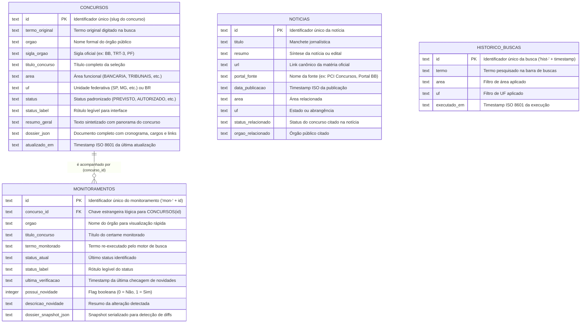
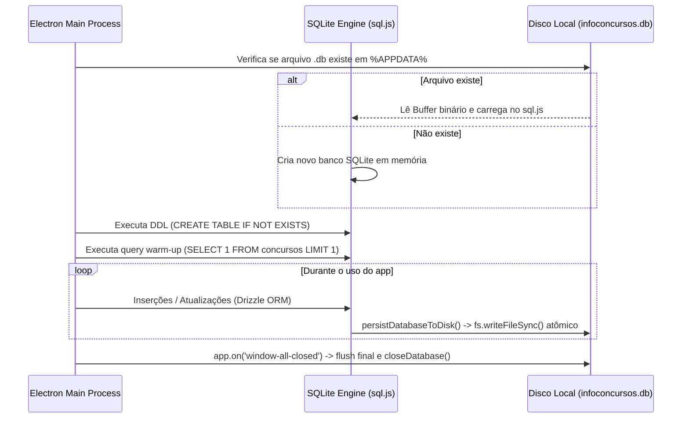

# Documentação do Banco de Dados: InfoConcursos Desktop

Esta documentação detalha a arquitetura de persistência, schemas, tipos de dados, relacionamentos e estratégias de armazenamento local adotadas no **InfoConcursos**.

---

## 1. Visão Geral da Arquitetura de Dados

O InfoConcursos utiliza uma arquitetura de banco de dados **relacional local e descentralizada** no hardware do usuário, eliminando custos de infraestrutura em nuvem, garantindo privacidade e latência de consulta inferior a 10ms.

- **Motor SQLite:** `sql.js` (WebAssembly SQLite) + persistência binária síncrona no disco.
- **ORM / Query Builder:** `drizzle-orm` (com tipagem estática ponta-a-ponta em TypeScript).
- **Localização Padrão do Arquivo:**
  - **Windows:** `%APPDATA%\infoconcursos\infoconcursos.db`
  - **Linux / macOS:** `~/.config/infoconcursos/infoconcursos.db`
- **Modo de Operação:** Single-file database com gravação em buffer e escrita atômica via `fs.writeFileSync`.

---

## 2. Diagrama Entidade-Relacionamento (ERD)



---

## 3. Dicionário de Dados e Schemas Detalhados

Código de referência: [`src/main/database/schema.ts`](file:///c:/Users/Dev/develop/infoconcursos/src/main/database/schema.ts)

### 3.1 Tabela `concursos`
Armazena o cache consolidado dos concursos descobertos e os dossiês estruturados de estudo.

| Coluna SQLite | Tipo SQL | Tipo TypeScript | Restrições | Descrição Funcional |
| :--- | :--- | :--- | :--- | :--- |
| `id` | `TEXT` | `string` | `PRIMARY KEY` | Chave única (ex: `dossier-banco-do-brasil-2026`, `dossier-trt-mg-2026`). |
| `termo_original` | `TEXT` | `string` | `NOT NULL` | Termo ou expressão que originou a criação do registro. |
| `orgao` | `TEXT` | `string` | `NOT NULL` | Nome completo da instituição (ex: *Banco do Brasil S.A.*). |
| `sigla_orgao` | `TEXT` | `string \| null` | `NULLABLE` | Sigla representativa para chips e listas (ex: *BB*, *TRT-3*, *PF*). |
| `titulo_concurso` | `TEXT` | `string` | `NOT NULL` | Título do certame exibido em destaque no card principal. |
| `area` | `TEXT` | `ConcursoArea` | `NOT NULL` | Enum: `BANCARIA`, `TRIBUNAIS`, `POLICIAL`, `FISCAL_CONTROLE`, etc. |
| `uf` | `TEXT` | `string` | `NOT NULL` | Sigla do estado (`SP`, `MG`) ou `BR` para certames nacionais. |
| `status` | `TEXT` | `ConcursoStatus` | `NOT NULL` | Enum: `PREVISTO`, `COMISSAO_FORMADA`, `AUTORIZADO`, `EDITAL_PUBLICADO`. |
| `status_label` | `TEXT` | `string` | `NOT NULL` | Texto legível de apresentação (ex: *"Banca Definida (Edital Iminente)"*). |
| `resumo_geral` | `TEXT` | `string` | `NOT NULL` | Síntese de 2 a 3 frases com o contexto do concurso. |
| `dossier_json` | `TEXT` | `string` (JSON) | `NOT NULL` | Objeto completo `ConcursoDossier` (cargos, salários, matérias, links). |
| `atualizado_em` | `TEXT` | `string` (ISO) | `NOT NULL` | Data/hora da última sincronização ou scraping. |

#### Estrutura do Campo `dossier_json` (Exemplo Real):
```json
{
  "id": "dossier-banco-do-brasil-2026",
  "orgao": "Banco do Brasil S.A.",
  "status": "PREVISTO",
  "banca": {
    "nome": "Fundação Cesgranrio",
    "situacao": "COTADA_OU_HISTORICO",
    "observacao": "Banca histórica com contratos recentes vigentes."
  },
  "cronograma": {
    "previsaoEdital": "Previsto para 2026",
    "periodoInscricoes": "A definir no edital",
    "dataProvaPrevista": "Estimada entre 60 e 75 dias após o edital",
    "ultimaMovimentacao": "Planejamento para novo edital de Escriturário."
  },
  "cargosPrevistos": [
    {
      "titulo": "Escriturário — Agente Comercial",
      "escolaridade": "MEDIO",
      "vagas": "2.000 a 4.000 vagas estimadas",
      "remuneracao": "R$ 5.684,00 (Salário + Benefícios)",
      "descricaoAtribuicoes": "Atendimento e comercialização bancária."
    }
  ],
  "materiasRecomendadas": [
    "Língua Portuguesa",
    "Conhecimentos Bancários",
    "Vendas e Negociação",
    "Matemática Financeira"
  ],
  "linksReferencia": [
    {
      "id": "ref-bb-1",
      "titulo": "Portal Oficial de Concursos do BB",
      "url": "https://www.bb.com.br/site/concurso-bb/",
      "fonte": "bb.com.br",
      "tipo": "PORTAL_OFICIAL"
    }
  ]
}
```

---

### 3.2 Tabela `monitoramentos`
Mantém o registro dos concursos que o usuário escolheu acompanhar ativamente, armazenando snapshots para detecção de alterações (diffs).

| Coluna SQLite | Tipo SQL | Tipo TypeScript | Restrições | Descrição Funcional |
| :--- | :--- | :--- | :--- | :--- |
| `id` | `TEXT` | `string` | `PRIMARY KEY` | Prefixo `mon-` + ID do concurso. |
| `concurso_id` | `TEXT` | `string` | `NOT NULL` | Referência lógica para `concursos(id)`. |
| `orgao` | `TEXT` | `string` | `NOT NULL` | Nome do órgão público monitorado. |
| `titulo_concurso` | `TEXT` | `string` | `NOT NULL` | Título da oportunidade para visualização na lista de acompanhamento. |
| `termo_monitorado` | `TEXT` | `string` | `NOT NULL` | Expressão utilizada pelo serviço de checagem em background. |
| `status_atual` | `TEXT` | `ConcursoStatus` | `NOT NULL` | Status identificado na última verificação. |
| `status_label` | `TEXT` | `string` | `NOT NULL` | Rótulo formatado do status para a UI. |
| `ultima_verificacao`| `TEXT` | `string` (ISO) | `NOT NULL` | Data e hora em que a última verificação nas fontes ocorreu. |
| `possui_novidade` | `INTEGER` | `boolean` (0 ou 1) | `NOT NULL DEFAULT 0`| `1` indica que houve mudança de status ou novas fontes desde o snapshot. |
| `descricao_novidade`| `TEXT` | `string \| null` | `NULLABLE` | Mensagem explicativa (ex: *"Mudança de situação: de Previsto para Edital Publicado"*). |
| `dossier_snapshot_json`| `TEXT` | `string` (JSON) | `NOT NULL` | Snapshot do dossiê no momento do acompanhamento para cálculo do diff. |

---

### 3.3 Tabela `noticias`
Armazena o histórico e o cache de matérias jornalísticas capturadas dos portais de notícias e agregadores.

| Coluna SQLite | Tipo SQL | Tipo TypeScript | Restrições | Descrição Funcional |
| :--- | :--- | :--- | :--- | :--- |
| `id` | `TEXT` | `string` | `PRIMARY KEY` | Hash ou identificador único da matéria. |
| `titulo` | `TEXT` | `string` | `NOT NULL` | Manchete da notícia sobre o concurso/edital. |
| `resumo` | `TEXT` | `string` | `NOT NULL` | Texto explicativo da oportunidade ou movimentação. |
| `url` | `TEXT` | `string` | `NOT NULL` | URL canônica externa da notícia original. |
| `portal_fonte` | `TEXT` | `string` | `NOT NULL` | Nome do portal ou órgão emissor (ex: *PCI Concursos*, *Gov.br*). |
| `data_publicacao` | `TEXT` | `string` (ISO) | `NOT NULL` | Data de publicação original da matéria. |
| `area` | `TEXT` | `ConcursoArea` | `NOT NULL` | Área temática inferida. |
| `uf` | `TEXT` | `string` | `NOT NULL` | Estado ou indicador nacional `BR`. |
| `status_relacionado`| `TEXT` | `ConcursoStatus` | `NOT NULL` | Situação inferida (Previsto, Autorizado, Edital Aberto). |
| `orgao_relacionado` | `TEXT` | `string` | `NOT NULL` | Nome do órgão para permitir abertura rápida de Dossiê correspondente. |

---

### 3.4 Tabela `historico_buscas`
Registra as pesquisas efetuadas pelo usuário na aplicação para fins de histórico e sugestões futuras.

| Coluna SQLite | Tipo SQL | Tipo TypeScript | Restrições | Descrição Funcional |
| :--- | :--- | :--- | :--- | :--- |
| `id` | `TEXT` | `string` | `PRIMARY KEY` | Identificador com prefixo `hist-` + timestamp. |
| `termo` | `TEXT` | `string` | `NOT NULL` | Texto digitado ou rótulo do filtro selecionado. |
| `area` | `TEXT` | `string` | `NOT NULL` | Área selecionada no momento da busca (`TODOS`, `TRIBUNAIS`, etc.). |
| `uf` | `TEXT` | `string` | `NOT NULL` | Filtro regional aplicado (`TODOS`, `SP`, `MG`, etc.). |
| `executado_em` | `TEXT` | `string` (ISO) | `NOT NULL` | Data/hora da consulta. |

---

## 4. Relacionamento e Integridade dos Dados

### Relacionamento Lógico: `concursos` 1 : N `monitoramentos`
- Cada registro em `monitoramentos` aponta para o identificador canônico de um concurso através da chave `concurso_id`.
- **Estratégia de Sincronização:** Quando o usuário clica em *"Visualizar Dossiê Completo"* na tela de Acompanhamentos, o app tenta abrir o snapshot salvo em `dossier_snapshot_json` de forma imediata (offline-first). Em paralelo, se houver rede, re-executa a busca para buscar dados ainda mais recentes.
- **Deleção em Cascata Lógica:** Quando o usuário desmarca o acompanhamento de um concurso, a remoção ocorre através de:
  ```typescript
  db.delete(monitoramentosTable).where(eq(monitoramentosTable.concursoId, id)).run()
  ```

---

## 5. Ciclo de Vida da Conexão & Persistência em Disco

A conexão é gerenciada pelo módulo [`src/main/database/index.ts`](file:///c:/Users/Dev/develop/infoconcursos/src/main/database/index.ts):



---

## 6. Índices Recomendados para Otimização de Escala

Caso o volume de dados em cache ultrapasse milhares de editais em versões futuras, recomenda-se a criação dos seguintes índices no SQLite:

```sql
-- Otimização de buscas por área e status na tela de Descoberta
CREATE INDEX IF NOT EXISTS idx_concursos_area_status ON concursos(area, status);

-- Otimização de filtragem regional
CREATE INDEX IF NOT EXISTS idx_concursos_uf ON concursos(uf);

-- Busca rápida de acompanhamentos por concurso
CREATE INDEX IF NOT EXISTS idx_monitoramentos_concurso_id ON monitoramentos(concurso_id);

-- Ordenação do feed de notícias por data decrescente
CREATE INDEX IF NOT EXISTS idx_noticias_data ON noticias(data_publicacao DESC);
```
