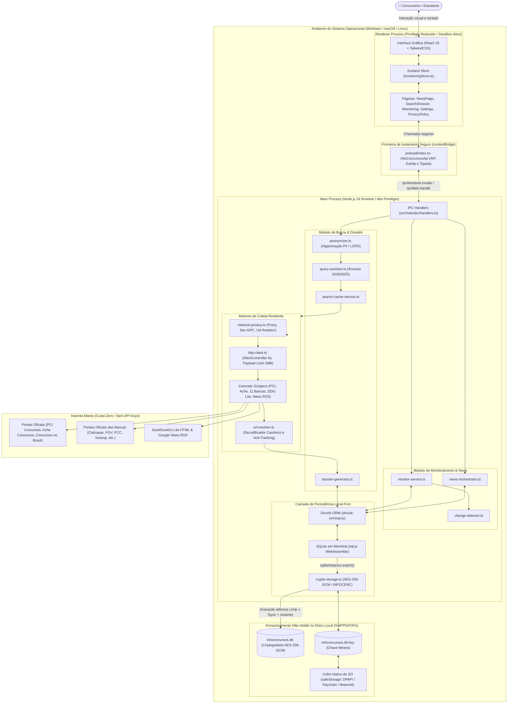
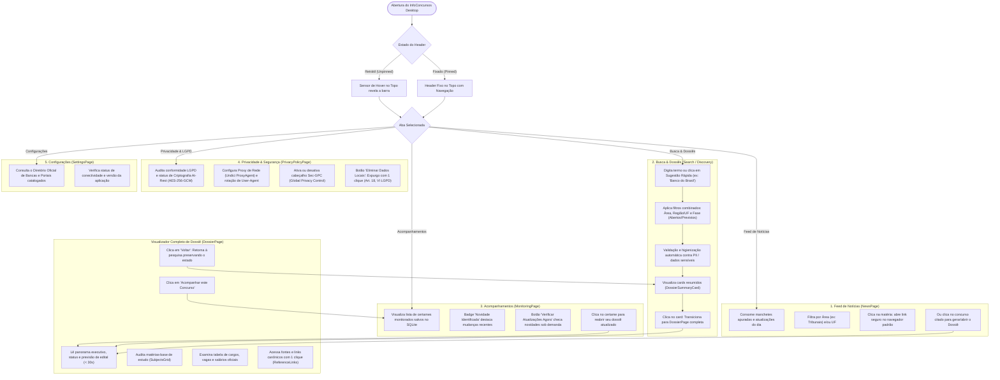
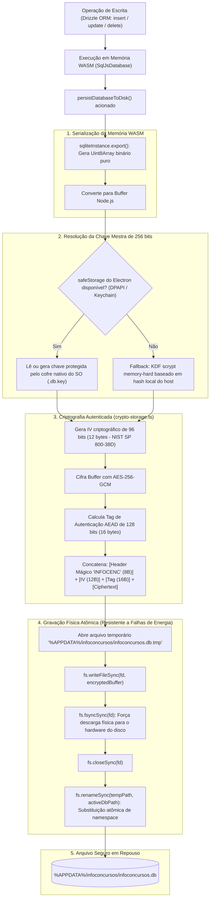
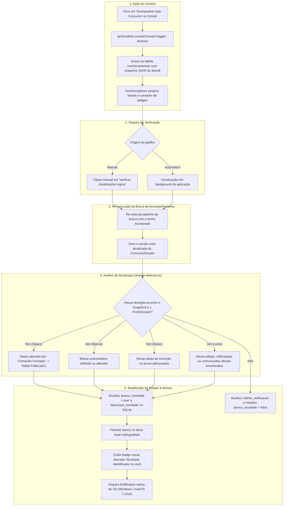
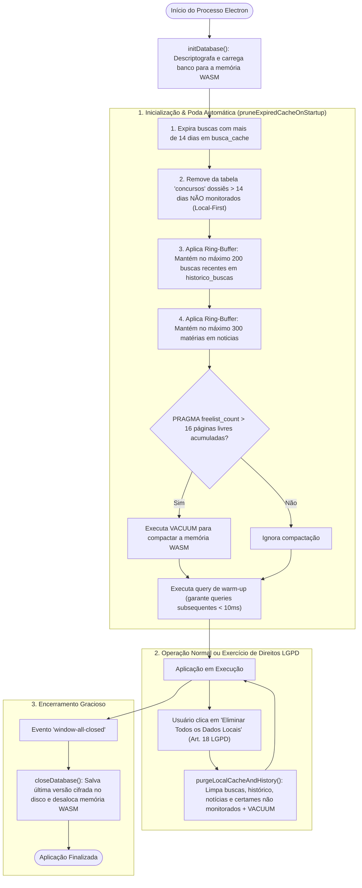

# Fluxogramas Arquiteturais & Operacionais — InfoConcursos Desktop

Este documento reúne a especificação visual e os diagramas de fluxo do **InfoConcursos Desktop**, modelados segundo os padrões internacionais de arquitetura de software (**ISO/IEC/IEEE 42010** e **C4 Model** de Simon Brown).

Os diagramas cobrem desde as jornadas completas dos perfis de usuário até os fluxos internos de isolamento do Electron, higienização de termos de busca contra vazamentos de dados (LGPD), persistência criptográfica em repouso (`AES-256-GCM`) e detecção de novidades em certames públicos.

---

## 1. Visão de Contêineres e Fronteiras de Isolamento (C4 Model — Nível 2)

Mapeia a segregação de responsabilidades e as barreiras de privilégio entre os processos do **Electron 34**, a memória WebAssembly, o disco criptografado do usuário e a camada de transporte de rede:

---

## 2. Jornada Completa do Usuário (5 Abas & Visualização de Dossiês)

Demonstra como o estudante navega pelas cinco abas editoriais e interage com os dossiês detalhados e ferramentas de privacidade:

---

## 3. Pipeline Modernizado de Buscas e Proteção de Dados (LGPD + Anti-Retroatividade)

Mapeia a entrada da busca, a higienização de dados pessoais, o roteamento de cache e a execução concorrente de scrapers:

```mermaid
flowchart TD
    subgraph Entrada ["1. Entrada do Usuário"]
        InputTerm["Termo digitado (ex: 'TRT-3', 'Banco do Brasil') + Filtros"]
        IPCInv["ipcRenderer.invoke('discovery:search', filter, options)"]
    end

    subgraph ValidaPII ["2. Validação & Higienização LGPD (anonymizer.ts)"]
        CheckPII{"Contém CPF, RG, E-mail ou Nome de Candidato?"}
        BlockPII["Bloqueia busca imediata / Retorna warning sem persistir"]
        CleanTerm["Sanitiza e mascara dados sensíveis para persistência"]
    end

    subgraph CacheRoute ["3. Roteamento de Cache (Local-First)"]
        CheckForce{"options.forceRefresh == true?"}
        LookupCache["getCachedSearchResults(): Consulta busca_cache no SQLite"]
        CacheHit{"Resultados válidos em cache?"}
        ReturnCache["Retorna Dossiês do SQLite (< 10ms)"]
    end

    subgraph SanitizaQuery ["4. Sanitização & Injeção de Âncoras Temporais"]
        QuerySanitizer["query-sanitizer.ts"]
        InjectAnchors["Injeta âncoras temporais (2026 / 2025)"]
        InjectExclusions["Injeta exclusões estritas (-'resultado final 2021', -'2022', -'homologado')"]
    end

    subgraph TransporteSeguro ["5. Camada de Rede Segura (http-client.ts)"]
        NetPrivacyConfig["network-privacy.ts: Aplica Proxy (Undici), Sec-GPC e UA Hardened"]
        SafetyWrapper["fetchHtmlWithSafety(): AbortController 6000ms + Limite de 2MB"]
    end

    subgraph ScrapersExec ["6. Coleta Concorrente Resiliente (Promise.allSettled)"]
        P1["Portais: PCI Concursos, Ache Concursos, Concursos no Brasil"]
        P2["Bancas Diretas: FGV, Cebraspe, FCC, Vunesp, Idecan, etc."]
        P3["DuckDuckGo Lite HTML & Google News RSS"]
    end

    subgraph NormalizaFiltra ["7. Normalização & Filtro de Obsolescência"]
        UrlCleaner["url-resolver.ts: Decodifica URLs canônicas, limpa UTMs e trackers"]
        ObsolescenceFilter{"isResultCurrent(): O edital é recente (2025/2026/Previsto)?"}
        DiscardItem["Descarta resultado antigo/homologado"]
        AproveItem["Aprova item para síntese"]
    end

    subgraph SinteseDossier ["8. Extração de Entidades & Síntese (< 30s)"]
        ExtStatus["status-detector.ts: Normaliza Status (Previsto, Comissão, Edital)"]
        ExtDate["date-extractor.ts: Extrai Cronograma e Prazos"]
        ExtMat["syllabus-matcher.ts: Mapeia Matérias Recomendadas por Área"]
        GenDossier["dossier-generator.ts: Compila ConcursoDossier Estruturado"]
    end

    subgraph SalvaCache ["9. Persistência & Cache"]
        SaveCacheTable["Grava chaves e IDs em busca_cache e concursos"]
        SaveHistTable["Registra termo higienizado em historico_buscas"]
        ReturnUI["Entrega lista de ConcursoDossier à UI"]
    end

    InputTerm --> IPCInv --> CheckPII
    CheckPII -->|"Sim (Dados pessoais inválidos)"| BlockPII
    CheckPII -->|"Não (Termo público válido)"| CleanTerm --> CheckForce

    CheckForce -->|"Não"| LookupCache --> CacheHit
    CacheHit -->|"Sim"| ReturnCache
    CacheHit -->|"Não"| QuerySanitizer
    CheckForce -->|"Sim"| QuerySanitizer

    QuerySanitizer --> InjectAnchors --> InjectExclusions --> NetPrivacyConfig
    NetPrivacyConfig --> SafetyWrapper --> ScrapersExec
    ScrapersExec --> P1 & P2 & P3 --> UrlCleaner --> ObsolescenceFilter

    ObsolescenceFilter -->|"Antigo (2018-2023)"| DiscardItem
    ObsolescenceFilter -->|"Válido"| AproveItem --> ExtStatus & ExtDate & ExtMat --> GenDossier

    GenDossier --> SaveCacheTable --> SaveHistTable --> ReturnUI
```

---

## 4. Ciclo de Persistência em Repouso & Criptografia At-Rest

Apresenta o fluxo de gravação atômica, encriptação com `AES-256-GCM` e proteção da chave mestra via cofre de senhas do Sistema Operacional:

---

## 5. Ciclo de Monitoramento Ativo e Detecção de Diffs

Detalhamento do monitoramento de certames favoritados e disparo de notificações no SO:

---

## 6. Ciclo de Vida da Aplicação, Poda de Cache & Expurgo LGPD

Mapeia a governança de dados na abertura e encerramento da aplicação:

