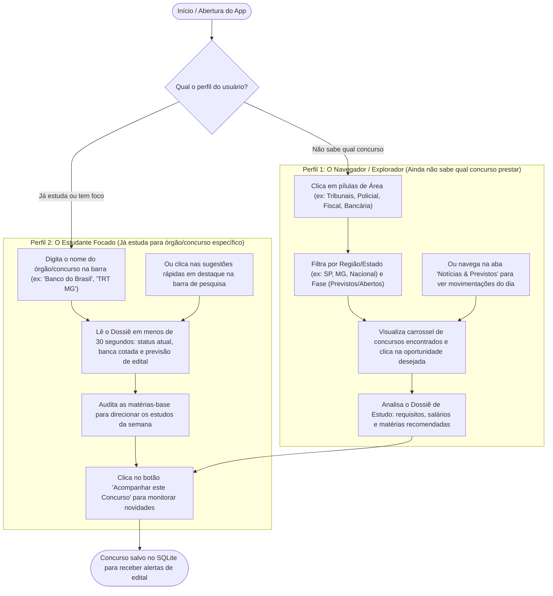
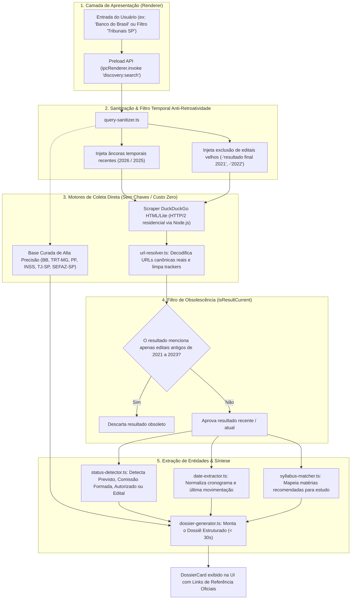
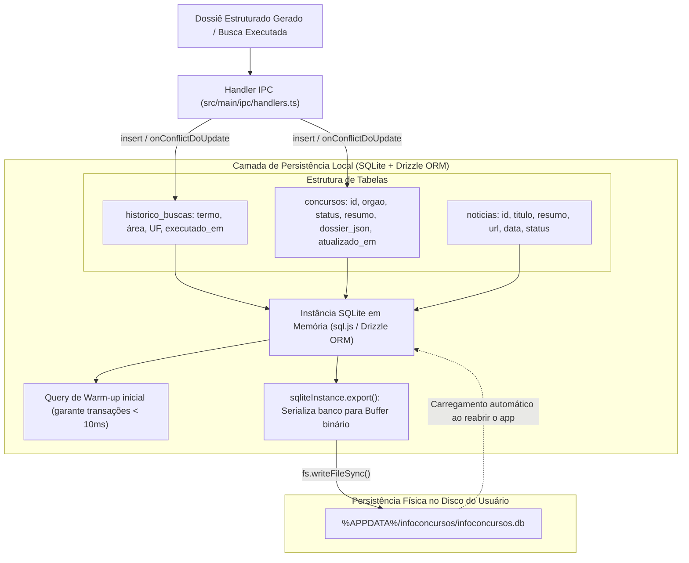
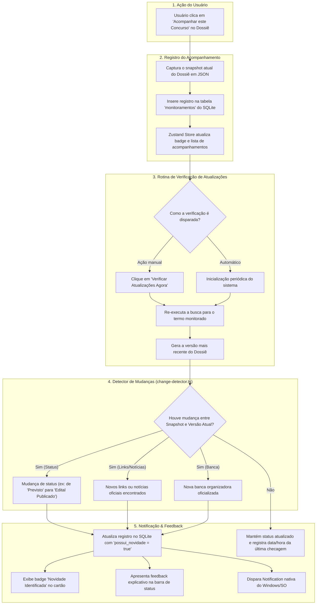

# Fluxogramas Arquiteturais & Operacionais — InfoConcursos Desktop

Este documento reúne a especificação visual e os diagramas de fluxo do **InfoConcursos Desktop**, detalhando a jornada dos perfis de usuário, o motor invisível de buscas, a persistência no banco local SQLite e o ciclo de acompanhamento/notificações.

---

## 1. Fluxo do Usuário por Perfil de Acesso

Demonstra como cada tipo de concurseiro navega pela aplicação para atingir seu objetivo sem atritos:

---

## 2. Fluxo Atual das Buscas (Motor Invisível & Filtro Temporal)

Mapeia como a consulta do usuário é traduzida nos bastidores com âncoras temporais recentes (`2026`/`2025`), descarte de concursos antigos/homologados e consolidação do Dossiê:

---

## 3. Fluxo de Armazenamento dos Resultados no SQLite Local

Apresenta a arquitetura de persistência descentralizada em arquivo binário no disco do usuário:

---

## 4. Fluxo de Acompanhamento, Verificação e Notificação

Detalhamento do ciclo de monitoramento ativo de concursos favoritados e emissão de alertas nativos do sistema:

