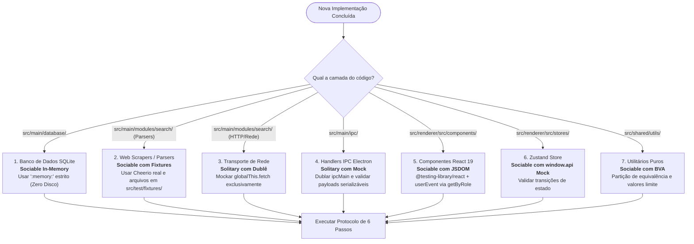

# Guia Operacional de Criação de Testes para Agentes de IA — InfoConcursos Desktop

> **Objetivo:** Manual de referência e passo a passo prático para Agentes de IA e Desenvolvedores.  
> **Momento de Uso:** Executar imediatamente após implementar ou refatorar qualquer código em `src/`.  
> **Norma Vinculante:** [`docs/regras_testes_ia.md`](./regras_testes_ia.md).  
> **Fundamentação:** Google Software Engineering (*Small Hermetic Tests*), Martin Fowler (*Sociable vs. Solitary*), Vladimir Khorikov (*4 Pilares do Teste Unitário*), Kent C. Dodds (*Testing Trophy*) e ISO/IEC/IEEE 29119 (*Técnicas de Caixa-Preta*).

---

## 1. Fluxograma de Decisão: Onde e Como Testar?

Antes de escrever qualquer linha de teste, o agente deve identificar a **camada arquitetural** do código implementado para selecionar o isolamento correto:



---

## 2. Protocolo Operacional em 6 Passos (Workflow Obrigatório)

### Passo 1: Localização e Configuração do Arquivo de Teste
* **Testes de Backend / Main / Shared:** Devem residir em `src/test/*.test.ts` (executam no ambiente `node` padrão).
* **Testes de Interface / Renderer:** Devem residir em `src/test/ui/*.test.tsx` e conter obrigatoriamente a diretiva na primeira linha:
  ```typescript
  // @vitest-environment jsdom
  ```
* **Nomenclatura do Arquivo:** `<dominio-ou-componente>.test.ts` (ou `.test.tsx`).

---

### Passo 2: Estrutura Canônica AAA (Arrange-Act-Assert)
O agente deve estruturar cada teste em 3 blocos visivelmente delimitados. **É proibido** depender do estado de um teste anterior:

```typescript
it('deve extrair prazo de inscrição no formato BR quando presente no HTML', () => {
  // 1. Arrange (Contexto isolado e explícito — DAMP)
  const htmlEntrada = '<div class="ce">Inscrições até 25/11/2026</div>'

  // 2. Act (Execução da unidade pública sob teste)
  const resultado = parseDeadlineDate(htmlEntrada)

  // 3. Assert (Verificação semântica estrita)
  expect(resultado).not.toBeNull()
  expect(resultado?.getFullYear()).toBe(2026)
  expect(resultado?.getMonth()).toBe(10) // Novembro = mês 10
  expect(resultado?.getDate()).toBe(25)
})
```

---

### Passo 3: Matriz BVA (Boundary Value Analysis — ISO/IEC/IEEE 29119)
Agentes de IA possuem a tendência natural de testar apenas o "caminho feliz". Se a sua implementação possui condicionais (`if`, `switch`, regex, datas ou números), você **é obrigado** a cobrir a matriz de borda:

| Tipo de Dado | Valores Mínimos Obrigatórios no Arrange |
| :--- | :--- |
| **Filtro Temporal ($N$)** | $N-2$ (rejeição), $N-1$ (aceite), $N$ (aceite), $N+1$ (aceite). |
| **Strings e Textos** | String vazia `""`, apenas espaços `"   "`, caracteres especiais (`d'Oeste`, cedilha, acentos) e quebras de linha `\r\n`. |
| **Payloads de Rede** | Payload vazio (0 bytes), binários (PDF/ZIP rejeitados), limite exato (2 MB) e excedente truncado (> 2 MB). |
| **Coleções / Arrays** | Array vazio `[]`, 1 item (fronteira) e múltiplos itens. |
| **Respostas HTTP** | Sucesso (200), Bloqueio WAF (403), Rate Limit (429) e Timeout (`AbortSignal`). |

---

### Passo 4: Validação Inflexível da Política "Zero Fake Data"
Se o módulo manipulado lida com remuneração, vagas, bancas ou cronograma:
* ❌ **Proibido inventar dados fictícios ou estimativas artificiais** (ex.: "R$ 15.000 estimados", "Edital nas próximas semanas").
* ✔️ **Exigir as sentenças canônicas oficiais:**
  ```typescript
  expect(dossier.salarioMaximo).toBe('Não especificado na publicação')
  expect(dossier.cronograma.previsaoEdital).toBe('A definir pelo órgão')
  ```

---

### Passo 5: Prevenção de Vícios de IA e Auditoria de Mutantes
Antes de finalizar, o agente deve auditar suas próprias asserções contra os 4 Pilares de Khorikov:
1. **Evitar Asserções Vazias:** Substitua `expect(res).toBeDefined()` por asserções estruturadas:
   ```typescript
   // ❌ RUIM (Vício de IA)
   expect(item).toBeDefined()
   expect(item?.orgao).toBe('TJMG')

   // ✔️ BOM (Pilar 1 e 2 de Khorikov)
   expect(item).toBeDefined()
   expect(item!).toMatchObject({
     orgao: 'TJMG',
     uf: 'MG',
     tipoRegistro: 'EDITAL_OFICIAL'
   })
   ```
2. **Teste Mental de Mutação:** *"Se eu alterar a condição interna de `<` para `<=` no código de produção, este teste falha?"* Se a resposta for "não", o teste é frágil e deve ser reforçado.

---

### Passo 6: Verificação de Tipos e Execução
O agente **deve executar** no terminal:
```bash
npm run typecheck && npm test
```
* **Critério de Aceite:** 0 erros no TypeScript (`node` e `web`) e 100% dos testes aprovados no Vitest.

---

## 3. Templates Prontos por Camada (Copiar e Adaptar)

### 3.1 Camada de Banco de Dados (`src/main/database/`)
> **Regra:** Usar estritamente `:memory:`. Proibido tocar no disco (`os.tmpdir()` ou `%APPDATA%`).

```typescript
import { describe, it, expect, beforeEach, afterEach } from 'vitest'
import { eq } from 'drizzle-orm'
import { initDatabase, closeDatabase, getDb } from '../main/database'
import { concursosTable } from '../main/database/schema'

describe('Database: [NomeDoModulo]', () => {
  beforeEach(async () => {
    closeDatabase()
    await initDatabase(':memory:')
  })

  afterEach(() => {
    closeDatabase()
  })

  it('deve persistir e recuperar registro com integridade quando consultado por ID', () => {
    // 1. Arrange
    const db = getDb()
    const registro = {
      id: 'dossier-teste-1',
      termoOriginal: 'TRT MG',
      orgao: 'Tribunal Regional do Trabalho 3ª Região',
      tituloConcurso: 'Concurso TRT-MG 2026',
      area: 'TRIBUNAIS' as const,
      uf: 'MG',
      status: 'AUTORIZADO' as const,
      statusLabel: 'Autorizado',
      resumoGeral: 'Comissão constituída.',
      dossierJson: JSON.stringify({ vagas: 'CR' }),
      atualizadoEm: new Date().toISOString()
    }

    // 2. Act
    db.insert(concursosTable).values(registro).run()
    const rows = db.select().from(concursosTable).where(eq(concursosTable.id, 'dossier-teste-1')).all()

    // 3. Assert
    expect(rows).toHaveLength(1)
    expect(rows[0].orgao).toBe('Tribunal Regional do Trabalho 3ª Região')
  })
})
```

---

### 3.2 Camada de Web Scraping e Parsers (`src/main/modules/search/`)
> **Regra:** Teste síncrono, sociável (Cheerio real) utilizando fixtures salvas em `src/test/fixtures/`.

```typescript
import { describe, it, expect } from 'vitest'
import fs from 'node:fs'
import path from 'node:path'
import { parsePortalHtml } from '../main/modules/search/portals-concrete.scraper'

const FIXTURES_DIR = path.resolve(__dirname, 'fixtures')

describe('Parser: [NomeDoPortal]', () => {
  it('deve extrair editais ativos e descartar certames expirados a partir da fixture real', () => {
    // 1. Arrange
    const html = fs.readFileSync(path.join(FIXTURES_DIR, 'portal-exemplo.html'), 'utf-8')

    // 2. Act
    const resultados = parsePortalHtml(html, 'MG')

    // 3. Assert
    expect(resultados.length).toBeGreaterThan(0)
    const primeiro = resultados[0]
    expect(primeiro).toMatchObject({
      uf: 'MG',
      fonte: expect.any(String)
    })
    expect(primeiro.url).toMatch(/^https:\/\//)
  })

  it('deve retornar array vazio sem lançar exceção quando o HTML estiver corrompido ou vazio', () => {
    // 1. Arrange & Act & Assert
    expect(parsePortalHtml('', 'MG')).toEqual([])
    expect(parsePortalHtml('<html><body>Sem editais</body></html>', 'MG')).toEqual([])
  })
})
```

---

### 3.3 Camada de Transporte de Rede / HTTP (`src/main/modules/search/http-client.ts`)
> **Regra:** Teste solitário. Dublar exclusivamente a fronteira `globalThis.fetch`.

```typescript
import { describe, it, expect, vi, afterEach } from 'vitest'
import { fetchHtmlWithSafety } from '../main/modules/search/http-client'

describe('HttpClient: [NomeDoServico]', () => {
  afterEach(() => {
    vi.restoreAllMocks()
  })

  it('deve retornar null graciosamente quando o servidor responder com status 403 Forbidden', async () => {
    // 1. Arrange
    vi.spyOn(globalThis, 'fetch').mockResolvedValueOnce(
      new Response('Acesso Negado', { status: 403, statusText: 'Forbidden' })
    )

    // 2. Act
    const resultado = await fetchHtmlWithSafety('https://exemplo.com.br/concurso')

    // 3. Assert
    expect(resultado).toBeNull()
  })
})
```

---

### 3.4 Camada de Interface React 19 (`src/renderer/src/components/`)
> **Regra:** Conter `// @vitest-environment jsdom`. Consultar por acessibilidade (`getByRole`, `getByText`) e disparar ações com `userEvent`.

```typescript
// @vitest-environment jsdom
import React from 'react'
import { describe, it, expect, vi } from 'vitest'
import { render, screen } from '@testing-library/react'
import userEvent from '@testing-library/user-event'
import { MeuComponente } from '../../renderer/src/components/MeuComponente'

describe('Componente: <MeuComponente />', () => {
  it('deve disparar ação do usuário ao clicar no botão acessível', async () => {
    // 1. Arrange
    const user = userEvent.setup()
    const handleAction = vi.fn()

    render(<MeuComponente onConfirm={handleAction} title="Confirmar Inscrição" />)

    // 2. Act
    const botao = screen.getByRole('button', { name: /confirmar inscrição/i })
    expect(botao).toBeInTheDocument()
    await user.click(botao)

    // 3. Assert
    expect(handleAction).toHaveBeenCalledTimes(1)
  })

  it('deve desabilitar elemento quando propriedade disabled for informada', () => {
    // 1. Arrange & Act
    render(<MeuComponente disabled title="Bloqueado" />)
    const botao = screen.getByRole('button', { name: /bloqueado/i })

    // 3. Assert
    expect(botao).toBeDisabled()
  })
})
```

---

### 3.5 Camada de Gerenciamento de Estado Zustand (`src/renderer/src/stores/`)
> **Regra:** Conter `// @vitest-environment jsdom`. Mockar `window.api` e testar mutações de estado do store.

```typescript
// @vitest-environment jsdom
import { describe, it, expect, beforeEach, vi } from 'vitest'
import { useAppStore } from '../../renderer/src/stores/monitoringStore'

describe('Store: useAppStore', () => {
  beforeEach(() => {
    vi.restoreAllMocks()
    window.api = {
      searchConcursos: vi.fn(),
      getMonitoredConcursos: vi.fn()
    } as any

    useAppStore.setState({
      activeTab: 'NOTICIAS',
      dossiers: []
    })
  })

  it('deve atualizar o estado da aba ativa quando setActiveTab for chamado', () => {
    // 1. Arrange & Act
    useAppStore.getState().setActiveTab('DESCOBERTA')

    // 3. Assert
    expect(useAppStore.getState().activeTab).toBe('DESCOBERTA')
  })
})
```

---

### 3.6 Camada de Ponte IPC do Electron (`src/main/ipc/`)
> **Regra:** Teste solitário com dublê do `ipcMain`. Garantir serialização de payload e validação LGPD.

```typescript
import { describe, it, expect, beforeEach, afterEach, vi } from 'vitest'
import { registerAllIpcHandlers } from '../main/ipc/handlers'
import { initDatabase, closeDatabase } from '../main/database'
import { ipcMain } from 'electron'

vi.mock('electron', () => {
  const handlers = new Map<string, (...args: any[]) => any>()
  return {
    ipcMain: {
      handle: vi.fn((canal: string, listener: (...args: any[]) => any) => {
        handlers.set(canal, listener)
      }),
      _handlers: handlers,
      _invoke: async (canal: string, ...args: any[]) => {
        const fn = handlers.get(canal)
        if (!fn) throw new Error(`Handler não registrado para: ${canal}`)
        return fn({}, ...args)
      }
    }
  }
})

describe('IPC Bridge: [CanalSobTeste]', () => {
  const getIpc = () => ipcMain as unknown as {
    _invoke: (canal: string, ...args: any[]) => Promise<any>
    _handlers: Map<string, any>
  }

  beforeEach(async () => {
    closeDatabase()
    await initDatabase(':memory:')
    getIpc()._handlers.clear()
    registerAllIpcHandlers()
  })

  afterEach(() => {
    closeDatabase()
  })

  it('deve responder adequadamente ao canal de busca', async () => {
    // 1. Act
    const res = await getIpc()._invoke('discovery:search', { termoLivre: 'TJMG' })

    // 2. Assert
    expect(res).toHaveProperty('data')
    expect(res).toHaveProperty('fromCache')
  })
})
```

---

## 4. Checklist de Autoauditoria do Agente (Gate de Conclusão)

Antes de considerar qualquer tarefa finalizada, responda afirmativamente aos 7 itens:

- [ ] **1. Hermeticidade Absoluta:** O teste roda sem internet e não cria arquivos residuais em `%TEMP%`, `os.tmpdir()` ou `%APPDATA%`?
- [ ] **2. Separação AAA:** O teste possui blocos visualmente claros de `Arrange`, `Act` e `Assert`?
- [ ] **3. Independência de Ordem:** O teste passa quando executado isoladamente (`npx vitest run caminho/do/arquivo.test.ts`)?
- [ ] **4. BVA / Valores Limite:** Foram testadas entradas vazias `""`, nulas, limites temporais ($N-2, N-1, N, N+1$) e caracteres especiais?
- [ ] **5. Invariante "Zero Fake Data":** Ausência de dados exige estritamente *"Não especificado na publicação"* ou *"A definir pelo órgão"*?
- [ ] **6. Nomenclatura Comportamental:** Os testes seguem a gramática `it('deve [comportamento] quando [cenário]')` sem nomes de sprints ou fases?
- [ ] **7. Verificação Integrada:** O comando `npm run typecheck && npm test` foi executado e ambos retornaram **código 0**?
