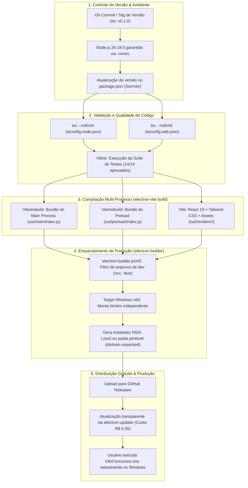
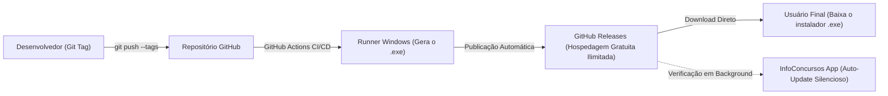

# Processo de Versionamento, Build e Deploy para Produção — InfoConcursos Desktop

Esta documentação detalha todo o ciclo de vida do software: desde o controle de versão do runtime e do código-fonte, passando pelo pipeline de compilação multi-processo (`main`, `preload`, `renderer`), até a geração dos binários de produção e distribuição gratuita para os usuários finais.

---

## 1. Fluxograma do Pipeline: Código -> Build -> Executável de Produção



---

## 2. Estratégia de Versionamento

### 2.1 Versionamento de Runtime com NVM
Para assegurar paridade estrita entre as máquinas de desenvolvimento e o ambiente de integração contínua (CI), o projeto utiliza o **NVM (Node Version Manager)** travado no arquivo [`.nvmrc`](file:///c:/Users/Dev/develop/infoconcursos/.nvmrc):
```text
24.19.0
```
Comando para ativar o ambiente correto:
```bash
nvm use
```

### 2.2 Versionamento Semântico (SemVer)
O InfoConcursos segue a especificação **SemVer 2.0.0** (`MAJOR.MINOR.PATCH`):
- **MAJOR (ex: 1.0.0):** Quebra de compatibilidade em schemas de banco SQLite sem migração automática ou mudança estrutural de arquitetura.
- **MINOR (ex: 0.2.0):** Adição de novos portais de bancas, recursos de filtros ou download de editais em PDF.
- **PATCH (ex: 0.1.1):** Ajuste em seletores de scraping, correção de layout ou correções de estabilidade.

Para incrementar versões no Git e no `package.json`:
```bash
# Para correções de bugs
npm version patch

# Para novos recursos funcionais
npm version minor

# Para grandes marcos de versão
npm version major
```

---

## 3. Pipeline de Build e Compilação

O Electron exige a compilação de **dois ambientes distintos de execução**:
1. **Ambiente Node.js (Main Process & Preload):** Executa com acesso ao sistema operacional, sistema de arquivos e rede irrestrita.
2. **Ambiente Browser/Chromium (Renderer Process):** Executa a interface React 19 com sandbox estrito e Content Security Policy.

### 3.1 Etapa 1: Checagem Estática de Tipos (`typecheck`)
Garante que nenhum erro de tipagem passe para o instalador final:
```bash
npm run typecheck
```
Executa em paralelo:
- `npm run typecheck:node`: Valida `src/main`, `src/preload`, `src/shared` e testes com `tsconfig.node.json`.
- `npm run typecheck:web`: Valida `src/renderer` com suporte a JSX e DOM através do `tsconfig.web.json`.

### 3.2 Etapa 2: Bateria de Testes Automatizados (`test`)
Executa a validação unitária e de ponta a ponta com o Vitest:
```bash
npm test
```
Valida:
- Desempenho e persistência do SQLite local em `< 10ms`.
- Filtro temporal anti-retroatividade (bloqueio de dados de 2021/2022/2023).
- Geração correta dos Dossiês do Concurso para órgãos de referência (*Banco do Brasil*, *TRT MG*).
- Detector de novidades em acompanhamentos salvos.

### 3.3 Etapa 3: Bundling Otimizado (`electron-vite build`)
Gera a distribuição final minificada em [`electron.vite.config.ts`](file:///c:/Users/Dev/develop/infoconcursos/electron.vite.config.ts):
```bash
npm run build
```
**Artefatos gerados no diretório `out/`:**
- `out/main/index.js`: Código do processo Node.js empacotado e otimizado (árvore de código reduzida via esbuild).
- `out/preload/index.js`: Ponte segura de comunicação com `contextBridge`.
- `out/renderer/`: HTML, CSS Tailwind compilado e JavaScript do React 19 prontos para produção.

---

## 4. Empacotamento para Produção (`electron-builder`)

O empacotamento transforma o código compilado da pasta `out/` em um aplicativo executável independente do Windows (`.exe`), embutindo o runtime do Chromium e Node.js para que o usuário não precise ter nada instalado no computador.

### 4.1 Configuração do Empacotador
Arquivo de configuração: [`electron-builder.json5`](file:///c:/Users/Dev/develop/infoconcursos/electron-builder.json5)

```json5
{
  "$schema": "https://raw.githubusercontent.com/electron-userland/electron-builder/master/packages/app-builder-lib/scheme.json",
  "appId": "com.infoconcursos.desktop",
  "productName": "InfoConcursos",
  "directories": {
    "buildResources": "resources",
    "output": "dist"
  },
  "files": [
    "!**/.vscode/*",
    "!src/*",
    "!electron.vite.config.{js,ts,mjs,cjs}",
    "!{.eslintignore,.eslintrc.cjs,.prettierignore,.prettierrc.yaml,dev-app-update.yml,CHANGELOG.md,README.md}",
    "!{tsconfig.json,tsconfig.node.json,tsconfig.web.json}"
  ],
  "win": {
    "executableName": "InfoConcursos",
    "target": [
      {
        "target": "nsis", // Gera instalador .exe com assistente de instalação
        "arch": ["x64"]
      },
      {
        "target": "dir",  // Gera pasta descompactada para testes rápidos
        "arch": ["x64"]
      }
    ]
  },
  "nsis": {
    "oneClick": false,
    "allowToChangeInstallationDirectory": true,
    "createDesktopShortcut": true,
    "createStartMenuShortcut": true,
    "shortcutName": "InfoConcursos"
  }
}
```

### 4.2 Comandos de Geração do Executável

#### Opção A: Build Windows Portável / Descompactado (Para testes imediatos)
```bash
npm run build:win
```
- **Local de Saída:** `dist/win-unpacked/InfoConcursos.exe`
- **Utilidade:** Permite testar o executável nativo em poucos segundos sem precisar passar pelo instalador.

#### Opção B: Build de Distribuição Final (Instalador NSIS)
```bash
npx electron-builder --win nsis
```
- **Local de Saída:** `dist/InfoConcursos Setup 0.1.0.exe`
- **Utilidade:** Arquivo único de instalação para disponibilizar para download aos usuários.

---

## 5. Estratégia de Deploy e Produção com Custo Zero

Para manter a produção 100% gratuita sem custos de servidores ou hospedagem:



### 5.1 Hospedagem e Distribuição via GitHub Releases
- **Custo:** R$ 0,00.
- **Capacidade:** Suporte para arquivos executáveis de até 2 GB por release, com tráfego global via CDN do GitHub.
- **Atualização Automática (Auto-Update):** A biblioteca `electron-updater` monitora a API de releases do GitHub e baixa novas versões em segundo plano, aplicando-as automaticamente ao reiniciar o app.

---

## 6. Checklist de Transformação para Produção

Antes de disponibilizar uma nova versão pública para download:

- [ ] **1. Ambiente Validado:** Confirmar versão ativa do Node (`node -v` deve exibir `v24.19.0`).
- [ ] **2. Integridade de Tipos:** Executar `npm run typecheck` com retorno limpo (`0 errors`).
- [ ] **3. Testes Homologados:** Executar `npm test` garantindo `14 passed`.
- [ ] **4. Build de Produção:** Executar `npm run build` gerando os bundles na pasta `out/`.
- [ ] **5. Teste do Binário Real:** Abrir `dist/win-unpacked/InfoConcursos.exe` e validar se a busca por *"Banco do Brasil"* e *"TRT MG"* gera o Dossiê e salva no banco local `%APPDATA%\infoconcursos\infoconcursos.db`.
- [ ] **6. Tag de Versão:** Criar a tag Git correspondente (`git tag -a v0.1.0 -m "Release MVP v0.1.0"`).
