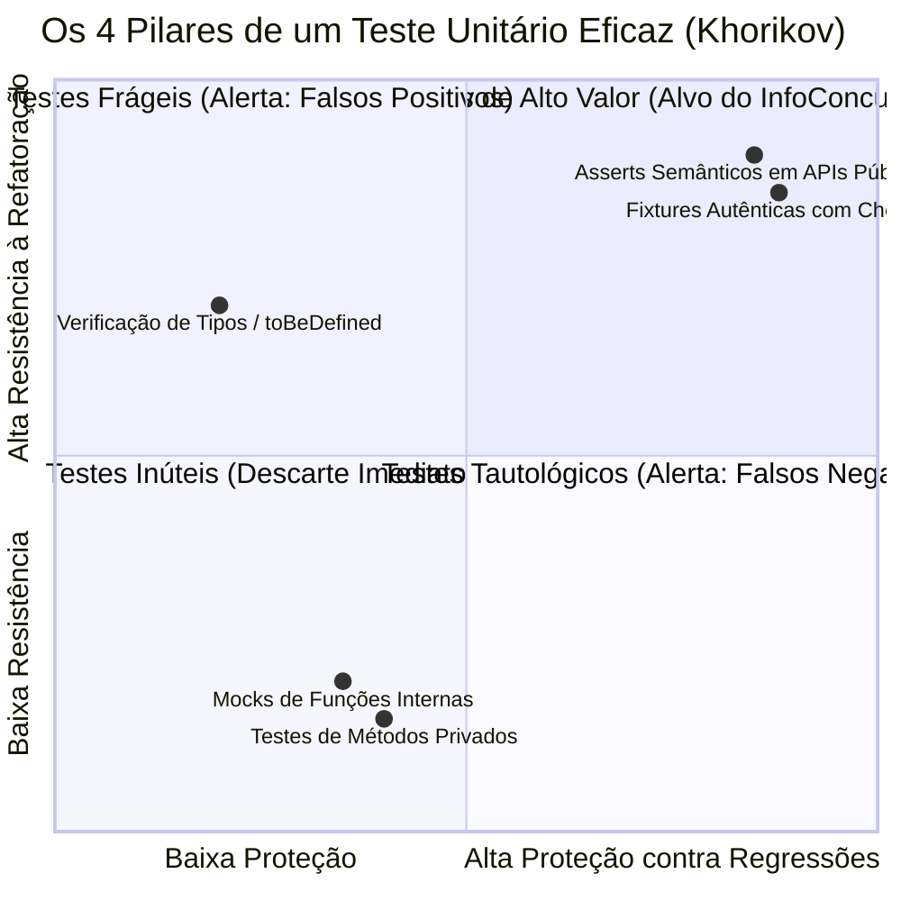
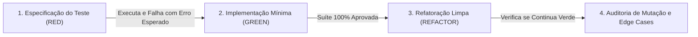

# Diretrizes e Regras de Testes Automatizados para Agentes de IA — InfoConcursos Desktop

> **Status:** Documento Normativo e Vinculante para Desenvolvedores e Agentes de IA (LLMs)  
> **Escopo:** Toda a base de código do InfoConcursos (`src/main`, `src/preload`, `src/renderer`, `src/shared`)  
> **Fundamentação Teórica:** Kent Beck (*Test Desiderata* e TDD), Martin Fowler (*Refactoring* e *Sociable Tests*), Google Software Engineering (*Small Hermetic Tests* e DAMP), Vladimir Khorikov (*4 Pilares do Teste Unitário*), Kent C. Dodds (*Testing Trophy*) e ISO/IEC/IEEE 29119 (*Técnicas de Caixa-Preta*).

---

## 1. Propósito e Filosofia de Qualidade

Este documento estabelece as **regras obrigatórias** que qualquer agente de Inteligência Artificial (Cursor, Copilot, Antigravity, Claude, ChatGPT, etc.) ou desenvolvedor humano deve seguir rigorosamente ao criar, refatorar, auditar ou manter testes automatizados no projeto **InfoConcursos Desktop**.

### 1.1 O "Problema do Oráculo" e os Vícios de IA
Modelos de linguagem possuem vícios sistemáticos na geração de código de testes:
1. **Testes Tautológicos (Bug-Encoding):** Ao gerar código e teste em conjunto, a IA tende a inspecionar a própria implementação com falha e escrever um teste que valida o comportamento incorreto como esperado.
2. **Uso Promíscuo de Mocks:** Isolamento artificial de funções puras ou colaboradores simples, criando testes que passam mas quebram na integração real.
3. **Asserts Vazios e Superficiais:** Testar apenas `expect(result).toBeDefined()` para inflar a métrica de cobertura de linhas sem verificar o estado semântico do dado.
4. **Acoplamento a Detalhes Privados:** Testar nomes de métodos privados e campos internos em vez de avaliar contratos públicos e efeitos colaterais visíveis.

### 1.2 Os 4 Pilares de um Teste Valioso (Vladimir Khorikov)
Todo teste escrito no InfoConcursos deve maximizar o produto dos quatro pilares:



1. **Proteção contra Regressões:** O teste deve falhar categoricamente se um bug for introduzido na regra de negócio.
2. **Resistência à Refatoração:** O teste **não pode quebrar** se o código interno for reestruturado sem alteração do comportamento externo (eliminação de falsos positivos).
3. **Feedback Rápido:** Execução em milissegundos no ambiente local.
4. **Manutenibilidade:** Código legível, DAMP, sem dependências opacas ou setups convolutos.

---

## 2. Classificação de Escopo e Hermeticidade (Google & Martin Fowler)

### 2.1 Regra de Hermeticidade Estrita (Google Small Tests)
Todo teste classificado como unitário deve ser **100% hermético**:
- ❌ **Proibido acesso à rede real:** Nenhuma chamada HTTP externa é permitida. Todas as chamadas de rede devem ser interceptadas via mock de transporte (`fetchHtmlWithSafety` ou `globalThis.fetch`).
- ❌ **Proibido I/O de disco para arquivos de banco de dados:** Proibido o uso de `os.tmpdir()` ou caminhos temporários no disco para testes unitários de banco. O SQLite (`sql.js`) deve ser instanciado estritamente com banco em memória (`:memory:`).
- ❌ **Proibido acoplamento temporal / timers reais:** Evite testes com `setTimeout` prolongados. Use `vi.useFakeTimers()` e `vi.advanceTimersByTime()` quando o tempo for relevante.

### 2.2 Testes Sociáveis vs. Solitários (Martin Fowler)

| Camada | Tipo Recomendado | Diretriz para o Agente de IA |
| :--- | :--- | :--- |
| **Parsers e Sanitizadores** | **Sociable (Real)** | Usar instâncias reais do Cheerio, regex de produção e dicionários oficiais de fontes. Proibido mockar funções utilitárias internas. |
| **Banco de Dados (Drizzle + sql.js)** | **Sociable (In-Memory)** | Usar a engine real do `sql.js` com persistência em `:memory:` e schema Drizzle real. Proibido mockar queries SQL. |
| **Clientes de Rede (HTTP)** | **Solitary (Dublês)** | Mockar exclusivamente a fronteira de transporte (`globalThis.fetch`), devolvendo fixtures HTML/XML ou responses sintéticas com status definidos (403, 429, timeout). |
| **Ponte IPC do Electron** | **Solitary (Dublês)** | Dublar `ipcRenderer.invoke` e manipuladores do `ipcMain` garantindo contratos serializáveis via JSON. |
| **Interface (React 19)** | **Sociable (Component + Stores)** | Renderizar o componente real com seus nós filhos usando `@testing-library/react`. Usar o store real Zustand (`monitoringStore`). |

---

## 3. Protocolo Operacional para Agentes de IA

### 3.1 Ciclo TDD Obrigatório (Red-Green-Refactor)
O agente de IA **está proibido** de gerar código de produção e testes unitários em um único bloco de geração sem separação analítica prévia.



1. **Fase RED (Especificação):**
   - O agente redige o teste baseando-se estritamente no contrato TypeScript (`src/shared/types/`) e nos requisitos dos documentos (`docs/`).
   - O teste deve expressar a expectativa funcional do negócio.
2. **Fase GREEN (Implementação):**
   - O agente escreve o código mínimo necessário para satisfazer as asserções.
3. **Fase REFACTOR (Lapidação):**
   - Limpeza de redundâncias mantendo a suíte verde.

### 3.2 Estrutura Canônica de um Teste: AAA / Given-When-Then
Todo bloco de teste gerado deve conter blocos claramente delimitados:

```typescript
it('deve descartar resultado obsoleto quando o ano for anterior ao ciclo permitido', () => {
  // 1. Arrange (Given / Contexto)
  const tituloAntigo = 'Edital Concurso Público 2021 - Homologação Final'
  const snippet = 'Lista de aprovados publicada em 2021.'
  const anoReferencia = 2026

  // 2. Act (When / Ação)
  const ehAtual = isResultCurrent(tituloAntigo, snippet, '2021-05-10', anoReferencia)

  // 3. Assert (Then / Verificação Semântica)
  expect(ehAtual).toBe(false)
})
```

### 3.3 Princípio DAMP sobre DRY em Testes (Google)
Em código de teste, **DAMP (Descriptive And Meaningful Phrases)** supera o DRY:
- **Não crie classes base complexas de teste:** O desenvolvedor ou auditor que abrir o arquivo deve compreender imediatamente todos os dados de entrada sem ter que navegar por três arquivos de utilitários genéricos.
- **Valores Literais Explícitos:** Prefira declarar dados locais completos no `Arrange` do que reutilizar objetos mutáveis globais que causam vazamento de estado entre testes.

### 3.4 Padrão de Nomenclatura Semântica
O agente deve estruturar as suítes utilizando a gramática comportamental:

```typescript
describe('ContextoOuModulo', () => {
  describe('funcionalidadeEspecifica()', () => {
    it('deve [resultado ou comportamento esperado] quando [cenário ou condição de entrada]', () => {
      // teste...
    })
  })
})
```

---

## 4. Matriz de Casos de Borda e Análise de Valores Limite (ISO/IEC/IEEE 29119)

Agentes de IA tendem a cobrir apenas o "caminho feliz" (*happy path*). Para qualquer novo módulo, parser ou manipulador de dados, o agente **é obrigado** a incluir na suíte a matriz abaixo:

### 4.1 BVA (Boundary Value Analysis) e Partição de Equivalência

| Dimensão sob Teste | Casos de Borda Obrigatórios | Exemplo de Teste no InfoConcursos |
| :--- | :--- | :--- |
| **Filtro Temporal de Editais** | $N-2$ (Rejeição imediata)<br>$N-1$ (Aceite / ano base)<br>$N$ (Aceite / ano corrente)<br>$N+1$ (Aceite / certame previsto) | Validar para ano base `2026` os anos `2024` (falso), `2025` (verdadeiro), `2026` (verdadeiro) e `2027` (verdadeiro). |
| **Payload de Rede e Memória** | Payload vazio (0 bytes)<br>Payload truncado / malformado<br>Payload no limite (2 MB)<br>Payload excedente (> 2 MB) | Rejeição graciosa de stream binário (PDF) e corte estrito em 2MB com log seguro. |
| **Tipografia e Normalização** | Strings vazias e apenas espaços<br>Nomes com acentos e cedilha<br>Nomes com apóstrofo e aspas<br>Presença da sigla "CR" | Extração de "Prefeitura de Santa Bárbara d'Oeste", "Fundação Getulio Vargas" e isolamento de `\bCR\b` contra palavras como "CRIANÇA". |
| **Datas e Prazos** | Formato ISO 8601 (`YYYY-MM-DD`)<br>Formato brasileiro (`DD/MM/YYYY`)<br>Formatos RFC HTTP<br>String não reconhecida | Extrair `25/11/2026` com precisão de dia/mês/ano e devolver `null` para strings corrompidas sem lançar `RangeError`. |

### 4.2 Invariante Inflexível "Zero Fake Data"
O agente de IA **jamais** pode criar testes que admitam a invenção de dados:
- ❌ **Proibido tolerar fallbacks alucinados:** Nenhum teste deve esperar expressões sintéticas como *"Edital nos próximos 3 meses"* ou *"Salário de R$ 15.000,00 estimado"*.
- ✔️ **Asserções de Fallbacks Honestos:** Se o dado não existir na publicação original, o teste deve exigir estritamente:
  ```typescript
  expect(dossier.cronograma.previsaoEdital).toBe('A definir pelo órgão')
  expect(dossier.salarioMaximo).toBe('Não especificado na publicação')
  ```

---

## 5. Guias de Implementação por Camada

### 5.1 Camada Principal: Banco de Dados SQLite em Memória (`src/main/database/`)

Para testes de banco de dados, o agente deve seguir rigorosamente a inicialização em memória:

```typescript
import { describe, it, expect, beforeAll, afterAll } from 'vitest'
import initSqlJs, { Database } from 'sql.js'
import { drizzle } from 'drizzle-orm/sql-js'
import { concursosTable } from '../main/database/schema'
import { eq } from 'drizzle-orm'

describe('Database Service (In-Memory Hermetic)', () => {
  let rawDb: Database
  let db: ReturnType<typeof drizzle>

  beforeAll(async () => {
    const SQL = await initSqlJs()
    rawDb = new SQL.Database() // Banco 100% em memória (zero disco)
    db = drizzle(rawDb)
    
    // Executa migrações/DDL inicial
    rawDb.run(`
      CREATE TABLE IF NOT EXISTS concursos (
        id TEXT PRIMARY KEY,
        termo_original TEXT NOT NULL,
        orgao TEXT NOT NULL,
        sigla_orgao TEXT,
        titulo_concurso TEXT NOT NULL,
        area TEXT NOT NULL,
        uf TEXT NOT NULL,
        status TEXT NOT NULL,
        status_label TEXT NOT NULL,
        resumo_geral TEXT NOT NULL,
        dossier_json TEXT NOT NULL,
        atualizado_em TEXT NOT NULL
      );
    `)
  })

  afterAll(() => {
    rawDb.close()
  })

  it('deve persistir e consultar dossiê estruturado sem tocar no disco físico', () => {
    db.insert(concursosTable).values({
      id: 'dossier-teste-in-memory',
      termoOriginal: 'TRT MG',
      orgao: 'Tribunal Regional do Trabalho 3ª Região',
      tituloConcurso: 'Concurso TRT MG 2026',
      area: 'TRIBUNAIS',
      uf: 'MG',
      status: 'AUTORIZADO',
      statusLabel: 'Autorizado',
      resumoGeral: 'Comissão organizadora constituída.',
      dossierJson: JSON.stringify({ vagas: 'CR' }),
      atualizadoEm: new Date().toISOString()
    }).run()

    const results = db.select().from(concursosTable).where(eq(concursosTable.id, 'dossier-teste-in-memory')).all()
    expect(results).toHaveLength(1)
    expect(results[0].orgao).toBe('Tribunal Regional do Trabalho 3ª Região')
  })
})
```

---

### 5.2 Camada de Scraping & Parsers (`src/main/modules/search/`)

Os testes de scraping devem ser síncronos e usar fixtures reais de HTML/XML armazenadas em `src/test/fixtures/`:

```typescript
import { describe, it, expect } from 'vitest'
import fs from 'node:fs'
import path from 'node:path'
import { parsePciHtml } from '../main/modules/search/portals-concrete.scraper'

describe('PCI Concursos Parser', () => {
  it('deve extrair editais concretos ativos e descartar concursos encerrados (.ea)', () => {
    const fixturePath = path.resolve(__dirname, 'fixtures/pci-concursos.html')
    const html = fs.readFileSync(fixturePath, 'utf-8')

    const resultado = parsePciHtml(html)

    expect(resultado.length).toBeGreaterThan(0)
    // Validação estrita de propriedades extraídas
    const item = resultado[0]
    expect(item).toHaveProperty('id')
    expect(item.id).toMatch(/^pci-[0-9a-f]{16}$/)
    expect(item.url).toMatch(/^https:\/\/www\.pciconcursos\.com\.br\//)
    expect(item.vagas).not.toBe('')
  })
})
```

---

### 5.3 Camada de Interface do Usuário React 19 (`src/renderer/`)

O agente deve aplicar as regras da **Testing Library** (Kent C. Dodds):
- Consultar nós preferencialmente por papel de acessibilidade (`getByRole`, `findByRole`) ou texto (`getByText`).
- Simular eventos com `@testing-library/user-event` em vez de `fireEvent`.
- Jamais inspecionar `state` interno ou props privadas.

Exemplo de padrão para componente do Design System:

```typescript
import { describe, it, expect } from 'vitest'
import { render, screen } from '@testing-library/react'
import userEvent from '@testing-library/user-event'
import { Button } from './Button'

describe('Componente Button (Design System)', () => {
  it('deve disparar o evento onClick ao ser acionado via clique do usuário', async () => {
    const user = userEvent.setup()
    let clicou = false
    const handleClick = () => { clicou = true }

    render(<Button onClick={handleClick}>Acompanhar Concurso</Button>)

    const botao = screen.getByRole('button', { name: /acompanhar concurso/i })
    expect(botao).toBeInTheDocument()

    await user.click(botao)
    expect(clicou).toBe(true)
  })

  it('não deve disparar onClick quando estiver na propriedade disabled', async () => {
    const user = userEvent.setup()
    let clicou = false
    render(<Button disabled onClick={() => { clicou = true }}>Processando</Button>)

    const botao = screen.getByRole('button', { name: /processando/i })
    expect(botao).toBeDisabled()

    await user.click(botao)
    expect(clicou).toBe(false)
  })
})
```

---

## 6. Prevenção de Falsos Positivos e Testes de Mutação (Stryker)

### 6.1 A Ilusão da Cobertura de Linhas (Line Coverage)
Uma cobertura de 95% gerada por IA pode conter **zero valor real** se as asserções forem fracas:
```typescript
// ANTI-PADRÃO FREQUENTE DE IA: Teste oco / Falso positivo
it('executa busca', async () => {
  const result = await searchService.execute('Banco do Brasil')
  expect(result).toBeDefined() // Não valida se os dados retornados estão corretos!
})
```

### 6.2 Critério de Avaliação por Sobrevivência de Mutantes
O agente deve se autoavaliar considerando:
> *"Se eu intencionalmente inverter uma condição `if (ano < 2025)` para `if (ano <= 2025)` no código de produção, o meu teste falha?"*

Se a resposta for "não", o teste falhou em seu objetivo primordial de **Proteção contra Regressões**. O agente deve reforçar imediatamente os `expect(...)` para validar os valores de saída exatos e condições limite.

---

## 7. Checklist de Autoauditoria para o Agente de IA

Antes de considerar qualquer tarefa de implementação ou teste concluída, o agente de IA **deve executar e responder afirmativamente** ao seguinte checklist interno:

```markdown
### Checklist Obrigatório de Testes (Agente de IA)

- [ ] **1. Hermeticidade Garantida:** O teste roda sem internet e não cria arquivos residuais em `%APPDATA%` ou `os.tmpdir()`?
- [ ] **2. Separação de Fases (AAA):** O teste possui blocos visualmente claros de Contexto (Arrange), Ação (Act) e Asserção (Assert)?
- [ ] **3. Foco em Comportamento:** O teste valida o retorno público e os efeitos da funcionalidade, sem espionar métodos privados?
- [ ] **4. Casos de Borda Incluídos:** Foram testadas entradas nulas, strings vazias, caracteres especiais, limites temporais e erros HTTP (403, 429, timeout)?
- [ ] **5. Conformidade "Zero Fake Data":** Os fallbacks de dados ausentes exigem estritamente as sentenças canônicas oficiais sem inventar estimativas?
- [ ] **6. DAMP e Semântica:** A nomenclatura segue o padrão `it('deve [comportamento] quando [cenário]')` e os dados de teste são compreensíveis localmente?
- [ ] **7. Verificação de Integridade:** O comando `npm test` foi executado e todos os testes passaram sem warnings de promises pendentes?
```

---

## 8. Referências Oficiais e Bibliografia Recomendada

1. **Beck, Kent.** *Test-Driven Development: By Example*. Addison-Wesley, 2002.
2. **Beck, Kent.** *Test Desiderata*. Kent Beck on Software, 2019.
3. **Fowler, Martin.** *Refactoring: Improving the Design of Existing Code (2nd Edition)*. Addison-Wesley, 2018.
4. **Fowler, Martin.** *Sociable and Solitary Unit Tests*. martinfowler.com, 2014.
5. **Winters, Titus; Manshreck, Tom; Wright, Hyrum.** *Software Engineering at Google: Lessons Learned from Programming Over Time*. O'Reilly Media, 2020. (Especialmente Capítulo 11: *Testing Overview* e Capítulo 12: *Unit Testing*).
6. **Khorikov, Vladimir.** *Unit Testing Principles, Practices, and Patterns*. Manning Publications, 2020.
7. **Meszaros, Gerard.** *xUnit Test Patterns: Refactoring Test Code*. Addison-Wesley, 2007.
8. **Dodds, Kent C.** *Write tests. Not too many. Mostly integration.* kentcdodds.com, 2018.
9. **ISO/IEC/IEEE 29119-4.** *Software and systems engineering — Software testing — Part 4: Test techniques*. ISO/IEC/IEEE, 2021.
